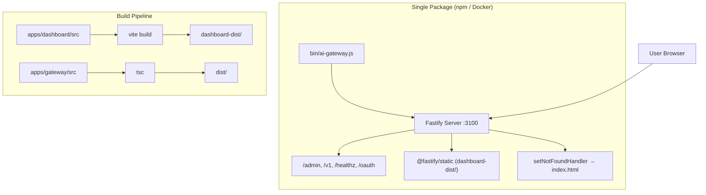
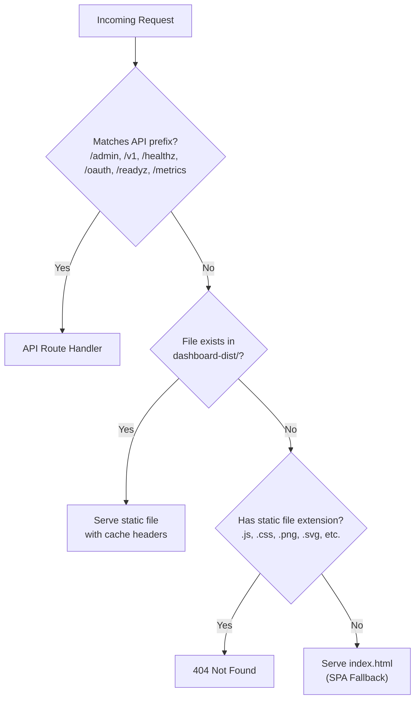

# Design Document: AI Gateway Single Package

## Overview

This design merges the AI Gateway (Fastify backend) and React Dashboard into a single deployable package. Currently the system runs as two separate services — gateway on port 3100 and dashboard on port 3000 via nginx. The unified architecture builds the dashboard into static files at package time and serves them directly from the Fastify gateway process.

**Key Design Decisions:**

1. **Static file serving via Fastify plugin** — Use `@fastify/static` to serve pre-built dashboard assets from a `dashboard-dist/` directory, avoiding custom file-serving logic.
2. **API route priority** — Register all API routes before the static file plugin, ensuring API prefixes (`/admin`, `/v1`, `/healthz`, `/oauth`) are never shadowed by the SPA fallback.
3. **SPA fallback as setNotFoundHandler** — Use Fastify's `setNotFoundHandler` to serve `index.html` for unmatched routes that don't target static file extensions, enabling client-side routing.
4. **Single CLI entry point** — A `bin/ai-gateway.js` script parses flags, validates environment, and starts the server — enabling `npx ai-gateway` usage.
5. **Multi-stage Dockerfile** — A single Dockerfile builds both dashboard and gateway, producing a minimal final image with only production artifacts.

## Architecture



**Request routing priority:**



## Components and Interfaces

### 1. Static File Serving Plugin (`src/plugins/dashboard.ts`)

A Fastify plugin that registers `@fastify/static` and configures SPA fallback behavior.

```typescript
interface DashboardPluginOptions {
  /** Absolute path to dashboard-dist/ directory */
  dashboardRoot: string;
  /** API route prefixes that should never be handled by static serving */
  apiPrefixes: string[];
}
```

**Responsibilities:**
- Register `@fastify/static` with `dashboard-dist/` as root
- Set cache headers based on filename hash pattern
- Implement SPA fallback via `setNotFoundHandler` for non-API, non-static-extension paths
- Return 404 for requests targeting static file extensions when file doesn't exist

### 2. CLI Entry Point (`bin/ai-gateway.js`)

```typescript
interface CLIOptions {
  port: number;      // default: 3100, range: 1-65535
  host: string;      // default: "0.0.0.0"
  help: boolean;     // display usage and exit
}
```

**Responsibilities:**
- Parse `--port`, `--host`, `--help` flags from `process.argv`
- Validate port range (1-65535, numeric)
- Check required environment variables (INTERNAL_API_KEYS, ADMIN_API_KEYS)
- Set PORT/HOST env vars and delegate to gateway server startup
- Handle port-in-use errors with clear messaging

### 3. Build Script (`scripts/build.sh` or npm scripts)

**Responsibilities:**
- Build dashboard: `cd apps/dashboard && npm ci && npm run build`
- Copy dashboard output to `dashboard-dist/`
- Build gateway: `cd apps/gateway && npm ci && npm run build`
- Copy gateway output to `dist/`
- Exit non-zero on any failure

### 4. Package Configuration (`package.json` at root)

```json
{
  "name": "ai-gateway",
  "version": "0.1.0",
  "type": "module",
  "bin": { "ai-gateway": "./bin/ai-gateway.js" },
  "files": ["bin/", "dist/", "dashboard-dist/"],
  "engines": { "node": ">=22" },
  "scripts": {
    "build": "node scripts/build.mjs",
    "prepack": "node scripts/build.mjs",
    "start": "node bin/ai-gateway.js"
  }
}
```

### 5. Unified Dockerfile

```dockerfile
# Stage 1: Build Dashboard
FROM node:22-alpine AS dashboard-build
WORKDIR /app/dashboard
COPY apps/dashboard/package.json apps/dashboard/package-lock.json ./
RUN npm ci
COPY apps/dashboard/ ./
RUN npm run build

# Stage 2: Build Gateway
FROM node:22-alpine AS gateway-build
WORKDIR /app/gateway
COPY apps/gateway/package.json apps/gateway/package-lock.json ./
RUN npm ci
COPY apps/gateway/ ./
RUN npm run build
RUN npm prune --omit=dev

# Stage 3: Final image
FROM node:22-alpine AS runner
WORKDIR /app
RUN addgroup -S gateway && adduser -S gateway -G gateway
COPY --from=gateway-build /app/gateway/dist ./dist
COPY --from=gateway-build /app/gateway/node_modules ./node_modules
COPY --from=gateway-build /app/gateway/package.json ./package.json
COPY --from=dashboard-build /app/dashboard/dist ./dashboard-dist
COPY bin/ ./bin/
USER gateway
EXPOSE 3100
HEALTHCHECK --interval=30s --timeout=5s --retries=3 \
  CMD node -e "fetch('http://127.0.0.1:3100/healthz').then(r=>process.exit(r.ok?0:1)).catch(()=>process.exit(1))"
CMD ["node", "bin/ai-gateway.js"]
```

## Data Models

### Static File Cache Strategy

| File Pattern | Cache-Control Header | Rationale |
|---|---|---|
| `*.[hash].*` (e.g., `main.a1b2c3.js`) | `public, max-age=31536000, immutable` | Content-addressed; safe to cache forever |
| `index.html` | `no-cache, no-store, must-revalidate` | Entry point must always be fresh |
| Other files without hash | `public, max-age=3600` | Short cache for non-hashed assets |

### CLI Flag Schema

| Flag | Type | Default | Validation |
|---|---|---|---|
| `--port` | number | 3100 | Integer, 1-65535 |
| `--host` | string | "0.0.0.0" | Non-empty string |
| `--help` | boolean | false | Presence flag |

### Required Environment Variables

| Variable | Required | Description |
|---|---|---|
| `INTERNAL_API_KEYS` | Yes | Comma-separated API keys for /v1 routes |
| `ADMIN_API_KEYS` | Yes (production) | Comma-separated API keys for /admin routes |

### Package Files Structure

```
ai-gateway/
├── bin/
│   └── ai-gateway.js          # CLI entry point
├── dist/                       # Compiled gateway TypeScript
│   ├── server.js
│   ├── app.js
│   ├── config.js
│   └── ...
├── dashboard-dist/             # Vite build output
│   ├── index.html
│   └── assets/
│       ├── main.[hash].js
│       ├── main.[hash].css
│       └── ...
└── package.json
```


## Correctness Properties

*A property is a characteristic or behavior that should hold true across all valid executions of a system — essentially, a formal statement about what the system should do. Properties serve as the bridge between human-readable specifications and machine-verifiable correctness guarantees.*

### Property 1: Content-Type determined by file extension

*For any* static file request where the file exists in `dashboard-dist/`, the response Content-Type header SHALL match the MIME type corresponding to the file's extension (e.g., `.js` → `application/javascript`, `.css` → `text/css`, `.png` → `image/png`).

**Validates: Requirements 2.2**

### Property 2: SPA fallback for non-API paths

*For any* request path that does not start with an API prefix (`/admin`, `/v1`, `/healthz`, `/oauth`, `/readyz`, `/metrics`) and does not have a static file extension (`.js`, `.css`, `.png`, `.svg`, `.ico`, `.woff`, `.woff2`, `.ttf`, `.map`), the Gateway SHALL respond with HTTP 200 and the contents of `index.html`.

**Validates: Requirements 2.3**

### Property 3: API route priority over static files

*For any* request path that starts with an API prefix (`/admin`, `/v1`, `/healthz`, `/oauth`), the Gateway SHALL never serve static file content or `index.html` from `dashboard-dist/`, regardless of whether a matching file exists in that directory.

**Validates: Requirements 2.4**

### Property 4: Cache-Control based on filename hash pattern

*For any* static file served from `dashboard-dist/`, if the filename matches the pattern `*.[hash].*` (where hash is 8+ hexadecimal characters), the Cache-Control header SHALL be `public, max-age=31536000, immutable`. For `index.html`, the Cache-Control header SHALL be `no-cache, no-store, must-revalidate`.

**Validates: Requirements 2.5**

### Property 5: 404 for missing static file extensions

*For any* request path that has a static file extension (`.js`, `.css`, `.png`, `.svg`, `.ico`, `.woff`, `.woff2`, `.ttf`, `.map`, `.jpg`, `.jpeg`, `.gif`, `.webp`) but the corresponding file does not exist in `dashboard-dist/`, the Gateway SHALL respond with HTTP 404.

**Validates: Requirements 2.6**

### Property 6: Port validation

*For any* input value passed to the `--port` CLI flag, the CLI SHALL accept it if and only if it is a string representation of an integer in the range [1, 65535]. All other values (non-numeric strings, floats, zero, negative numbers, numbers > 65535) SHALL cause the CLI to exit with a non-zero code and an error message.

**Validates: Requirements 3.3, 3.4**

## Error Handling

### Build Errors

| Scenario | Behavior |
|---|---|
| Dashboard source missing | Exit code 1, stderr: "Dashboard source directory not found: apps/dashboard/" |
| Dashboard build fails (tsc or vite) | Exit code 1, stderr: full build error output from the failing tool |
| Gateway build fails (tsc) | Exit code 1, stderr: full TypeScript compilation errors |
| prepack failure | Exit code 1, prevents `npm publish` from completing |

### Runtime Errors

| Scenario | Behavior |
|---|---|
| Port already in use | Exit code 1, stderr: "Port {port} is already in use" |
| Invalid --port value | Exit code 1, stderr: "Invalid port: {value}. Must be an integer between 1 and 65535" |
| Missing INTERNAL_API_KEYS | Exit code 1, stderr: "Missing required environment variable: INTERNAL_API_KEYS" |
| Missing ADMIN_API_KEYS (production) | Exit code 1, stderr: "Missing required environment variable: ADMIN_API_KEYS" |
| dashboard-dist/ missing at runtime | Log warning, serve 404 for all static/dashboard requests; API routes continue working |
| Static file read error (permissions) | 500 Internal Server Error with generic message |

### Graceful Shutdown

The gateway handles SIGTERM and SIGINT signals (already implemented in `server.ts`). The CLI entry point inherits this behavior — no additional shutdown logic needed.

## Testing Strategy

### Unit Tests

Unit tests cover specific examples, edge cases, and integration points:

- **CLI parsing**: Default values, --help output, missing env vars, port conflict error message
- **Build script**: Missing source directory, build failure propagation
- **Static serving**: Root path serves index.html, specific asset paths resolve correctly
- **Package.json validation**: All required fields present with correct values
- **Dockerfile structure**: Required directives present (EXPOSE, HEALTHCHECK, USER)

### Property-Based Tests

Property-based tests verify universal properties using `fast-check` (already a devDependency in the gateway):

- **Minimum 100 iterations** per property test
- Each test references its design document property via tag comment
- Tag format: `Feature: ai-gateway-single-package, Property {N}: {title}`

Properties to implement:
1. Content-Type mapping correctness (generate random valid extensions → verify MIME type)
2. SPA fallback routing (generate random non-API, non-static-extension paths → verify index.html)
3. API route priority (generate random API-prefixed paths → verify no static content)
4. Cache-Control header logic (generate random filenames with/without hash patterns → verify headers)
5. 404 for missing static extensions (generate random static-extension paths → verify 404)
6. Port validation (generate random strings/numbers → verify accept/reject matches predicate)

### Integration Tests

Integration tests verify end-to-end behavior:

- Docker build produces correct image with all artifacts
- Container starts and serves both API and dashboard on port 3100
- `npm pack` produces tarball with correct file structure
- Full request flow: API routes, static assets, SPA fallback all work together

### Test Framework

- **Unit & Property tests**: Vitest + fast-check (existing setup in `apps/gateway`)
- **Integration tests**: Vitest with HTTP client (fetch) against running server
- **Docker tests**: Shell scripts or Vitest with `child_process` for docker commands
