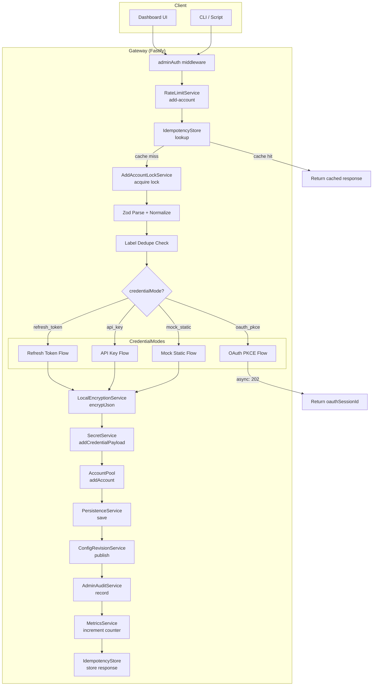
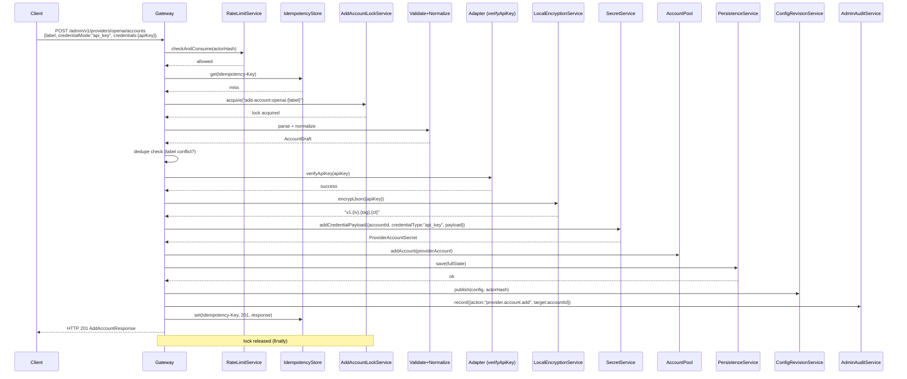
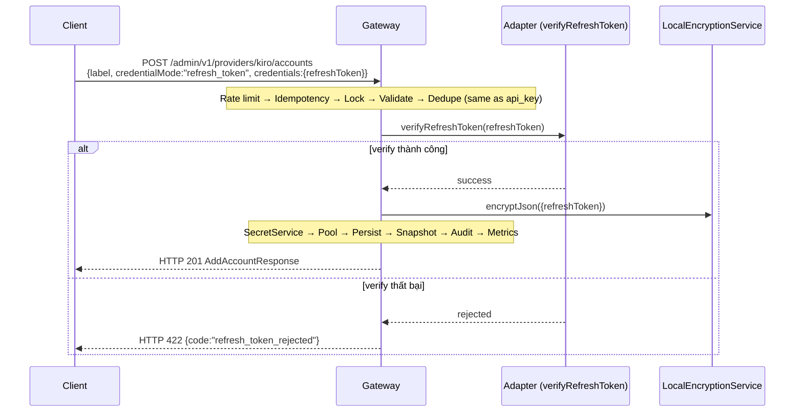
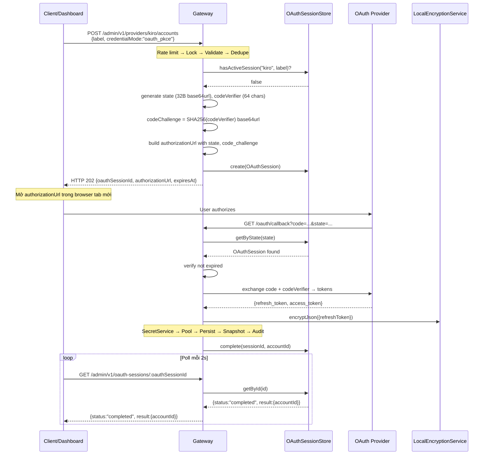
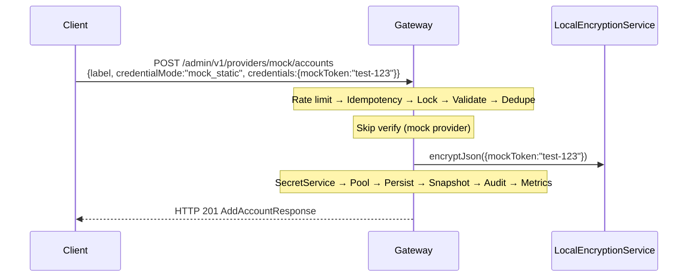
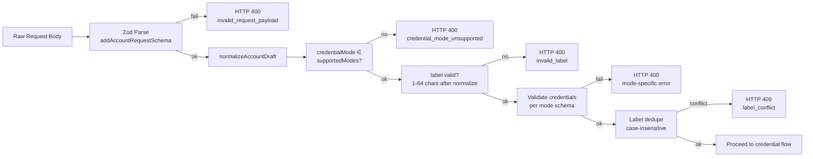

# Design Document — provider-add-account

## Overview

Tính năng `provider-add-account` bổ sung luồng thêm account hoàn chỉnh cho một provider type đã đăng ký. Thiết kế tận dụng tối đa các service hiện có (`SecretService`, `LocalEncryptionService`, `PersistenceService`, `ConfigRevisionService`, `AdminAuditService`, `MetricsService`, `AccountPool`) và chỉ bổ sung:

- **3 REST endpoint mới** dưới prefix `/admin/v1/providers/:providerType/accounts` (giữ nguyên prefix v1, không tạo v2)
- **1 endpoint poll OAuth** `GET /admin/v1/oauth-sessions/:oauthSessionId`
- **1 service mới** `AddAccountLockService` (wrapper KeyedMutex với timeout)
- **1 in-memory store** `IdempotencyStore` (TTL 10 phút)
- **1 in-memory store** `OAuthSessionStore` (TTL 10 phút)
- **1 RateLimitService instance** riêng cho add-account (đọc env `ADD_ACCOUNT_RATE_LIMIT_PER_MIN`)
- **Zod schema** cho `AddAccountRequest` và pipeline normalize
- **Dashboard component** `AddAccountModal` tích hợp vào `ProviderDetail`

Không thay đổi API v1 hiện có, không sửa adapter, không sửa `ProviderTypeDefinition` type (thay vào đó dùng mapping function từ `authMethods` sang `credentialMode`).

## Architecture

### Sơ đồ luồng tổng quan



### Quyết định thiết kế chính

| Quyết định | Lý do |
|---|---|
| Giữ prefix `/admin/v1/` | Không break client hiện có; endpoint mới nằm dưới sub-path `/providers/:type/accounts` |
| Mapping `authMethods` → `credentialMode` bằng function | Không sửa `ProviderTypeDefinition` type, tránh migration |
| `AddAccountLockService` riêng (không mở rộng `RefreshLockService`) | Separation of concerns; RefreshLockService dùng cho runtime refresh, AddAccountLockService cho admin flow |
| `OAuthSessionStore` in-memory với TTL | Đơn giản, phù hợp single-instance gateway; session chỉ sống 10 phút |
| `IdempotencyStore` in-memory với TTL | Tương tự; không cần Redis cho single-instance |
| `RateLimitService` instance riêng | Tách biệt rate limit add-account khỏi rate limit proxy chính |
| Dashboard: modal trong `ProviderDetail` | Tận dụng context provider đã có, không cần route mới |

## Components and Interfaces

### 1. REST Route Handler: `registerProviderAccountRoutes(app, deps)`

```typescript
// File: src/routes/providerAccounts.ts
import type { FastifyInstance } from "fastify";

type ProviderAccountRouteDeps = {
  accountPool: AccountPool;
  secretService: SecretService;
  persistenceService: PersistenceService;
  configRevisionService: ConfigRevisionService;
  auditService: AdminAuditService;
  metricsService: MetricsService;
  adapterRegistry: ProviderAdapterRegistry;
  addAccountLockService: AddAccountLockService;
  idempotencyStore: IdempotencyStore;
  oauthSessionStore: OAuthSessionStore;
  addAccountRateLimiter: RateLimitService;
  encryptionService: LocalEncryptionService;
};

async function registerProviderAccountRoutes(
  app: FastifyInstance,
  deps: ProviderAccountRouteDeps
): Promise<void>;
```

### 2. AddAccountLockService

```typescript
// File: src/services/AddAccountLockService.ts
import { KeyedMutex } from "../utils/mutex.js";

export class AddAccountLockService {
  private readonly mutex = new KeyedMutex();
  private readonly timeoutMs: number;

  constructor(timeoutMs = 5000) {
    this.timeoutMs = timeoutMs;
  }

  async acquire<T>(
    providerType: string,
    normalizedLabel: string,
    task: () => Promise<T>
  ): Promise<T>;
  // Throws AddAccountLockTimeoutError if timeout exceeded
}

export class AddAccountLockTimeoutError extends Error {
  readonly code = "add_account_in_progress";
  readonly statusCode = 409;
}
```

### 3. IdempotencyStore

```typescript
// File: src/services/IdempotencyStore.ts
export type IdempotencyRecord = {
  key: string;
  statusCode: number;
  body: unknown;
  createdAt: number; // Date.now()
};

export class IdempotencyStore {
  private readonly ttlMs: number; // default 600_000 (10 min)
  private readonly records = new Map<string, IdempotencyRecord>();

  constructor(ttlMs?: number);
  get(key: string): IdempotencyRecord | undefined;
  set(key: string, statusCode: number, body: unknown): void;
  // Auto-cleanup expired entries on get/set
}
```

### 4. OAuthSessionStore

```typescript
// File: src/services/OAuthSessionStore.ts
export type OAuthSession = {
  id: string;              // oauthSessionId (UUID)
  state: string;           // 32 bytes base64url
  codeVerifier: string;    // 64 chars random
  codeChallenge: string;   // SHA256(codeVerifier) base64url
  providerType: string;
  normalizedLabel: string;
  accountDraft: AccountDraft;
  authorizationUrl: string;
  status: "pending" | "completed" | "failed" | "expired";
  result?: { accountId: string } | { error: string };
  expiresAt: number;       // Date.now() + 600_000
  createdAt: number;
};

export class OAuthSessionStore {
  private readonly sessions = new Map<string, OAuthSession>();
  private readonly byState = new Map<string, string>(); // state → id

  create(session: Omit<OAuthSession, "status" | "createdAt">): OAuthSession;
  getById(id: string): OAuthSession | undefined;
  getByState(state: string): OAuthSession | undefined;
  hasActiveSession(providerType: string, normalizedLabel: string): boolean;
  complete(id: string, accountId: string): void;
  fail(id: string, error: string): void;
  // Auto-expire on access
}
```

### 5. Normalize Pipeline

```typescript
// File: src/services/addAccount/normalize.ts
export type AccountDraft = {
  label: string;           // normalized
  credentialMode: CredentialMode;
  weight: number;          // clamped [1, 100]
  enabled: boolean;        // default true
  maxConcurrency: number;  // default 3
  allowedModels?: string[];
  tags?: string[];
  owner?: string;
};

export type CredentialMode = "oauth_pkce" | "refresh_token" | "api_key" | "mock_static";

export function normalizeAddAccountRequest(raw: AddAccountRequestRaw): AccountDraft;
// - trim + collapse whitespace on label
// - clamp weight to [1, 100], floor decimals
// - default enabled = true, weight = 1
// Idempotent: normalize(normalize(x)) === normalize(x)
```

### 6. Credential Mode Mapping

```typescript
// File: src/services/addAccount/credentialModeMapping.ts
import type { ProviderAuthMethod } from "../../providers/registry/ProviderTypeDefinition.js";
import type { CredentialMode } from "./normalize.js";

// Maps existing authMethods to credentialMode
const AUTH_METHOD_TO_CREDENTIAL_MODE: Record<ProviderAuthMethod, CredentialMode | null> = {
  oauth: "oauth_pkce",
  refresh_token: "refresh_token",
  api_key: "api_key",
  bearer_token: "api_key",      // bearer_token uses same flow as api_key
  session_cookie: null,          // not supported in add-account flow
  custom_json: null,             // not supported in add-account flow
};

export function getSupportedCredentialModes(
  definition: ProviderTypeDefinition
): CredentialMode[];
// Special case: if definition.type === "mock", include "mock_static"
```

### 7. Dashboard Component: `AddAccountModal`

```typescript
// Trong apps/dashboard/src/App.tsx (hoặc tách file nếu refactor)
// Component AddAccountModal nhận props:
type AddAccountModalProps = {
  providerType: string;
  supportedModes: CredentialMode[];
  onClose: () => void;
  onSuccess: () => void;
};
```

## Data Models

### AddAccountRequest (REST DTO input)

```typescript
// Zod schema
const addAccountRequestSchema = z.object({
  label: z.string().min(1).max(200),  // raw, will be normalized
  credentialMode: z.enum(["oauth_pkce", "refresh_token", "api_key", "mock_static"]),
  weight: z.number().optional(),       // will be clamped
  enabled: z.boolean().optional(),     // default true
  maxConcurrency: z.number().int().positive().optional(), // default 3
  allowedModels: z.array(z.string().min(1)).optional(),
  tags: z.array(z.string().min(1)).optional(),
  owner: z.string().min(1).optional(),
  credentials: z.object({
    refreshToken: z.string().optional(),
    apiKey: z.string().optional(),
    mockToken: z.string().optional(),
  }).optional(),  // required for non-oauth modes
});
```

### AddAccountResponse (REST DTO output)

```typescript
type AddAccountResponse = {
  accountId: string;
  providerType: string;
  credentialMode: CredentialMode;
  label: string;
  enabled: boolean;
  weight: number;
  createdAt: string; // ISO 8601
};
// Không chứa bất kỳ trường secret nào
```

### OAuthStartResponse (HTTP 202)

```typescript
type OAuthStartResponse = {
  oauthSessionId: string;
  authorizationUrl: string;
  expiresAt: string; // ISO 8601
};
// Không chứa codeVerifier
```

### OAuthSessionStatus (GET /admin/v1/oauth-sessions/:id)

```typescript
type OAuthSessionStatusResponse = {
  id: string;
  status: "pending" | "completed" | "failed" | "expired";
  providerType: string;
  label: string;
  result?: { accountId: string } | { error: string; errorCode: string };
  expiresAt: string;
};
```

### ProviderAccountSummary (GET list response item)

```typescript
type ProviderAccountSummary = {
  accountId: string;
  label: string;
  credentialMode: CredentialMode;
  enabled: boolean;
  weight: number;
  createdAt: string;
};
```

### Mapping sang ProviderAccount hiện có

Khi commit account, `AccountDraft` được chuyển thành `ProviderAccount`:

| AccountDraft field | ProviderAccount field | Ghi chú |
|---|---|---|
| (generated UUID) | `id` | `crypto.randomUUID()` |
| (from providerType registry) | `providerInstanceId` | Lấy instance đầu tiên của providerType |
| providerType | `providerType` | Giữ nguyên |
| label | `displayName` | Dùng label đã normalize |
| enabled → true | `status` = "active" | enabled=false → "disabled" |
| weight | `weight` | Đã clamp |
| maxConcurrency | `maxConcurrency` | Default 3 |
| (secret ref) | `credentialRef` | Format: `secret_{accountId}` |
| allowedModels | `allowedModels` | Optional |
| tags | `tags` | Optional |
| owner | `owner` | Optional |
| (empty runtime) | `runtime` | All zeros |
| now | `createdAt`, `updatedAt` | |

### Nơi lưu trữ

| Data | Storage | TTL | Persist |
|---|---|---|---|
| ProviderAccount | `gateway-state.json` via PersistenceService | Vĩnh viễn | Có |
| ProviderAccountSecret | `gateway-state.json` (secrets array) | Vĩnh viễn | Có (encrypted) |
| OAuthSession | In-memory `OAuthSessionStore` | 10 phút | Không |
| IdempotencyRecord | In-memory `IdempotencyStore` | 10 phút | Không |
| Lock state | In-memory `KeyedMutex` | Tự giải phóng | Không |


## Sequence Diagrams

### Flow 1: Credential mode `api_key` (đồng bộ, tương tự `refresh_token`)



### Flow 2: Credential mode `refresh_token`



### Flow 3: Credential mode `oauth_pkce` (bất đồng bộ)



### Flow 4: Credential mode `mock_static`



## Encryption Boundary

### Nơi gọi `LocalEncryptionService`

| Thời điểm | Hàm gọi | Input | Output |
|---|---|---|---|
| Commit account (api_key) | `encryptJson({apiKey})` | `{apiKey: "sk-..."}` | `"v1.{iv}.{tag}.{ct}"` |
| Commit account (refresh_token) | `encryptJson({refreshToken})` | `{refreshToken: "rt_..."}` | `"v1.{iv}.{tag}.{ct}"` |
| Commit account (mock_static) | `encryptJson({mockToken})` | `{mockToken: "test"}` | `"v1.{iv}.{tag}.{ct}"` |
| OAuth callback (sau exchange) | `encryptJson({refreshToken, accessToken?})` | Token từ provider | `"v1.{iv}.{tag}.{ct}"` |

### Format ciphertext

```
v1.{iv_base64url}.{authTag_base64url}.{ciphertext_base64url}
```

- `v1`: version prefix
- `iv`: 12 bytes random, base64url encoded
- `authTag`: 16 bytes AES-GCM authentication tag, base64url encoded
- `ciphertext`: AES-256-GCM encrypted JSON payload, base64url encoded

### Ranh giới bảo mật

```
┌─────────────────────────────────────────────────┐
│  PLAINTEXT ZONE (chỉ trong memory, tạm thời)   │
│  - Request body (credentials.*)                  │
│  - Sau Zod parse, trước encrypt                  │
│  - Kết quả decryptJson (khi runtime cần dùng)   │
└─────────────────────────────────────────────────┘
         │ encryptJson()
         ▼
┌─────────────────────────────────────────────────┐
│  CIPHERTEXT ZONE (persist, log, response)       │
│  - SecretService.encryptedPayload               │
│  - gateway-state.json                            │
│  - ConfigRevision snapshot                       │
│  - Mọi log output                                │
│  - Mọi REST response                            │
└─────────────────────────────────────────────────┘
```

## Concurrency

### AddAccountLockService

Tạo service mới thay vì mở rộng `RefreshLockService` (separation of concerns):

```typescript
export class AddAccountLockService {
  private readonly mutex = new KeyedMutex();
  private readonly timeoutMs: number;

  constructor(timeoutMs = 5000) {
    this.timeoutMs = timeoutMs;
  }

  async acquire<T>(
    providerType: string,
    normalizedLabel: string,
    task: () => Promise<T>
  ): Promise<T> {
    const key = `add-account:${providerType}:${normalizedLabel}`;
    
    return Promise.race([
      this.mutex.runExclusive(key, task),
      this.timeout(key),
    ]) as Promise<T>;
  }

  private timeout(key: string): Promise<never> {
    return new Promise((_, reject) => {
      setTimeout(() => {
        reject(new AddAccountLockTimeoutError(key));
      }, this.timeoutMs);
    });
  }
}
```

**Lock key format**: `add-account:{providerType}:{normalizedLabel}`

Ví dụ: `add-account:kiro:my account` — serialize mọi request thêm account "my account" cho provider "kiro".

### Idempotency-Key

- Client gửi header `Idempotency-Key: <string>`
- Gateway kiểm tra `IdempotencyStore` trước khi acquire lock
- Nếu hit → trả lại response đã cache (statusCode + body)
- Nếu miss → thực hiện flow, lưu response vào store
- TTL: 10 phút, auto-cleanup trên mỗi get/set

### Race condition analysis

| Scenario | Giải pháp |
|---|---|
| 2 request cùng label cùng lúc | Lock serialize, request thứ 2 chờ hoặc timeout |
| OAuth callback + manual retry | Lock key khác nhau (callback dùng state lookup, không qua lock) |
| Persist fail giữa chừng | Không add vào pool nếu persist fail; state nhất quán |
| Idempotency-Key + lock timeout | Idempotency check trước lock → nếu đã có cache, trả ngay không cần lock |

## Audit + Metrics

### Audit Actions

| Action | targetType | targetId | Khi nào |
|---|---|---|---|
| `provider.account.add` | `account` | `{accountId}` | Commit thành công |
| `provider.account.add.failed` | `account` | `{providerType}` | Commit thất bại (persist error) |
| `provider.account.delete` | `account` | `{accountId}` | Xoá thành công |
| `provider.account.oauth.start` | `oauth_session` | `{oauthSessionId}` | Bắt đầu OAuth flow |
| `provider.account.oauth.complete` | `oauth_session` | `{oauthSessionId}` | OAuth callback thành công |

### Metrics

| Metric name | Type | Labels | Mô tả |
|---|---|---|---|
| `provider_accounts_added_total` | counter | `provider_type` | Số account đã thêm thành công |
| `provider_accounts_add_failed_total` | counter | `provider_type`, `error_code` | Số lần thêm thất bại |
| `provider_accounts_deleted_total` | counter | `provider_type` | Số account đã xoá |

Tích hợp vào `MetricsService` hiện có bằng cách gọi `recordRequest()` cho mỗi request (đã có sẵn qua Fastify hook) và thêm custom counter tracking trong route handler.

## Validation + Normalization Layer

### Pipeline



### Normalization function (idempotent)

```typescript
export function normalizeLabel(raw: string): string {
  return raw.trim().replace(/\s+/g, " ");
}

export function normalizeWeight(raw?: number): number {
  if (raw === undefined || raw === null) return 1;
  const floored = Math.floor(raw);
  return Math.max(1, Math.min(100, floored));
}

export function normalizeAddAccountRequest(raw: AddAccountRequestParsed): AccountDraft {
  return {
    label: normalizeLabel(raw.label),
    credentialMode: raw.credentialMode,
    weight: normalizeWeight(raw.weight),
    enabled: raw.enabled ?? true,
    maxConcurrency: raw.maxConcurrency ?? 3,
    allowedModels: raw.allowedModels,
    tags: raw.tags,
    owner: raw.owner,
  };
}
```

**Tính chất idempotent**: `normalizeAddAccountRequest(normalizeAddAccountRequest(x))` === `normalizeAddAccountRequest(x)` vì:
- `trim().replace(/\s+/g, " ")` áp dụng lần 2 không thay đổi (đã trim, đã collapse)
- `Math.max(1, Math.min(100, Math.floor(n)))` áp dụng lần 2 không thay đổi (đã là integer trong [1,100])
- Boolean và optional fields giữ nguyên

### Credential validation per mode

| Mode | Required field | Validation |
|---|---|---|
| `refresh_token` | `credentials.refreshToken` | Non-empty, ≤ 4096 chars |
| `api_key` | `credentials.apiKey` | 16–512 chars, ASCII printable only (`/^[\x20-\x7E]+$/`) |
| `mock_static` | `credentials.mockToken` | 1–256 chars |
| `oauth_pkce` | (none) | Không cần credentials trong request |

## Error Model

| Code | HTTP Status | Ý nghĩa | Redact |
|---|---|---|---|
| `provider_type_not_found` | 404 | providerType không tồn tại trong registry | Không |
| `admin_unauthenticated` | 401 | Thiếu/sai admin token | Không |
| `credential_mode_unsupported` | 400 | Mode không được provider hỗ trợ | Không |
| `invalid_request_payload` | 400 | Zod validation fail | Có (không hiện giá trị secret) |
| `invalid_label` | 400 | Label rỗng hoặc >64 chars sau normalize | Không |
| `label_conflict` | 409 | Trùng label (case-insensitive) cùng providerType | Không |
| `invalid_refresh_token` | 400 | refreshToken thiếu/rỗng/>4096 | Có |
| `invalid_api_key` | 400 | apiKey không đúng format | Có |
| `invalid_mock_token` | 400 | mockToken thiếu/rỗng/>256 | Không |
| `refresh_token_rejected` | 422 | Adapter verify thất bại | Có |
| `api_key_rejected` | 422 | Adapter verify thất bại | Có |
| `oauth_state_mismatch` | 400 | state callback không khớp session | Không |
| `oauth_session_expired` | 410 | Session đã hết hạn | Không |
| `oauth_exchange_failed` | 502 | Provider từ chối exchange code | Có |
| `oauth_session_in_progress` | 409 | Đã có session sống cho cùng label | Không |
| `add_account_in_progress` | 409 | Lock timeout (5s) | Không |
| `persist_failed` | 500 | Ghi file thất bại | Không |
| `rate_limited` | 429 | Vượt rate limit | Không (kèm Retry-After header) |
| `account_not_found` | 404 | accountId không tồn tại (DELETE) | Không |

### Error response format

```typescript
type ErrorResponse = {
  error: {
    code: string;
    message: string;
    details?: Array<{ field: string; message: string }>;
  };
};
```

## Rate Limiting

### Cấu hình

```typescript
// Đọc tại startup (src/config.ts)
const ADD_ACCOUNT_RATE_LIMIT_PER_MIN = parseAddAccountRateLimit(
  process.env.ADD_ACCOUNT_RATE_LIMIT_PER_MIN
);

function parseAddAccountRateLimit(raw?: string): number {
  if (!raw) return 10; // default
  const parsed = Number(raw);
  if (!Number.isInteger(parsed) || parsed <= 0) {
    throw new Error(
      `Invalid ADD_ACCOUNT_RATE_LIMIT_PER_MIN: expected positive integer, got "${raw}"`
    );
  }
  return parsed;
}
```

### Tích hợp

Tạo instance `RateLimitService` riêng cho add-account:

```typescript
const addAccountRateLimiter = new RateLimitService({
  requestsPerMinute: ADD_ACCOUNT_RATE_LIMIT_PER_MIN,
  dailyRequestQuota: 0, // unlimited daily
});
```

Gọi `addAccountRateLimiter.checkAndConsume(actorKeyHash)` ở đầu route handler, trước idempotency check.

Khi bị rate limit:
- HTTP 429
- Header `Retry-After: {seconds}` = số giây còn lại trong minute window
- Body: `{error: {code: "rate_limited", message: "..."}}`

## Dashboard Design

### Component Plan

Tận dụng `ProviderDetail` component hiện có trong `App.tsx`:

```
ProviderDetail (existing)
├── Account list (existing)
├── "Add account" button (NEW)
└── AddAccountModal (NEW)
    ├── LabelInput
    ├── CredentialModeDropdown
    ├── WeightInput (number, default 1)
    ├── EnabledToggle (default true)
    ├── CredentialFields (conditional)
    │   ├── RefreshTokenInput (mode=refresh_token)
    │   ├── ApiKeyInput (mode=api_key)
    │   ├── MockTokenInput (mode=mock_static)
    │   └── OAuthSection (mode=oauth_pkce)
    │       ├── "Continue with OAuth" button
    │       └── OAuthPollingStatus
    ├── ErrorMessages (Vietnamese)
    └── SubmitButton
```

### State Management

```typescript
// Trong AddAccountModal
const [formState, setFormState] = useState<AddAccountFormState>({
  label: "",
  credentialMode: supportedModes[0],
  weight: 1,
  enabled: true,
  credentials: {},
});
const [errors, setErrors] = useState<Record<string, string>>({});
const [submitting, setSubmitting] = useState(false);
const [oauthSession, setOauthSession] = useState<OAuthSessionPoll | null>(null);
```

### OAuth Polling

```typescript
// Khi mode = oauth_pkce và đã nhận oauthSessionId
useEffect(() => {
  if (!oauthSession?.id) return;
  const interval = setInterval(async () => {
    const res = await apiClient.get(`/admin/v1/oauth-sessions/${oauthSession.id}`);
    if (res.status === "completed") {
      clearInterval(interval);
      onSuccess();
    } else if (res.status === "failed" || res.status === "expired") {
      clearInterval(interval);
      setErrors({ oauth: res.result?.error ?? "OAuth thất bại" });
    }
  }, 2000);
  return () => clearInterval(interval);
}, [oauthSession?.id]);
```

### Logo Handling

```typescript
// Existing pattern in dashboard
const logoUrl = `/provider-logos/${providerType}.png`;
// onError fallback: hiển thị div với chữ cái đầu uppercase
 { e.currentTarget.style.display = 'none'; showPlaceholder(); }} />
```

### Error Messages (Vietnamese)

```typescript
const ERROR_MESSAGES_VI: Record<string, string> = {
  label_conflict: "Label đã tồn tại cho provider này",
  invalid_refresh_token: "Refresh token không hợp lệ (1-4096 ký tự)",
  invalid_api_key: "API key không hợp lệ (16-512 ký tự ASCII)",
  credential_mode_unsupported: "Chế độ credential không được hỗ trợ",
  invalid_label: "Label không hợp lệ (1-64 ký tự sau chuẩn hoá)",
  refresh_token_rejected: "Refresh token bị từ chối bởi provider",
  api_key_rejected: "API key bị từ chối bởi provider",
  oauth_session_in_progress: "Đang có phiên OAuth cho label này",
  rate_limited: "Quá nhiều yêu cầu, vui lòng thử lại sau",
  persist_failed: "Lỗi lưu trữ, vui lòng thử lại",
};
```


## Correctness Properties

*A property is a characteristic or behavior that should hold true across all valid executions of a system — essentially, a formal statement about what the system should do. Properties serve as the bridge between human-readable specifications and machine-verifiable correctness guarantees.*

### Property 1: Idempotent Normalization

*For any* `AddAccountRequest` input, applying `normalizeAddAccountRequest` twice SHALL produce the same result as applying it once: `normalize(normalize(x)) === normalize(x)`.

**Validates: Requirements 2.8**

### Property 2: Label Deduplication (case-insensitive)

*For any* two labels `L1` and `L2` where `normalize(L1).toLowerCase() === normalize(L2).toLowerCase()`, if an account with label `L1` already exists for a given `providerType`, then adding an account with label `L2` for the same `providerType` SHALL be rejected with `label_conflict`.

**Validates: Requirements 2.3**

### Property 3: Weight Clamping Invariant

*For any* numeric value `w` provided as weight, the normalized weight SHALL satisfy: `1 <= normalizeWeight(w) <= 100` AND `normalizeWeight(w)` is an integer.

**Validates: Requirements 2.4**

### Property 4: Credential Encryption Round-Trip

*For any* valid credential payload (containing `refreshToken`, `apiKey`, or `mockToken`), encrypting with `LocalEncryptionService.encryptJson(payload)` then decrypting with `LocalEncryptionService.decryptJson(ciphertext)` SHALL produce a value deeply equal to the original payload.

**Validates: Requirements 4.3, 5.3, 7.2, 7.5**

### Property 5: No Secrets in Response

*For any* successful `AddAccountResponse` or `OAuthStartResponse`, the response body SHALL NOT contain any of the fields: `refreshToken`, `apiKey`, `mockToken`, `code`, `codeVerifier`, `authorization`, or any value matching the encrypted payload format.

**Validates: Requirements 1.1, 3.2, 10.2**

### Property 6: OAuth State Uniqueness and Format

*For any* two `OAuthSession` objects created by the system, their `state` values SHALL be distinct, each `state` SHALL be exactly 32 bytes when decoded from base64url, and each `codeVerifier` SHALL be exactly 64 characters.

**Validates: Requirements 3.1**

### Property 7: Idempotency-Key Replay

*For any* valid `AddAccountRequest` with an `Idempotency-Key` header, sending the same request with the same key within 10 minutes SHALL return the identical response (same statusCode and body) without creating a second account.

**Validates: Requirements 9.3**

### Property 8: Rate Limit Enforcement

*For any* actor, after making `ADD_ACCOUNT_RATE_LIMIT_PER_MIN` requests within a 1-minute window, the next request SHALL be rejected with HTTP 429 and a `Retry-After` header with a positive integer value.

**Validates: Requirements 11.4**

## Error Handling

### Chiến lược xử lý lỗi

| Layer | Hành vi |
|---|---|
| Zod parse fail | Trả 400 ngay, không log secret values, trả field errors |
| Normalize fail (label invalid) | Trả 400, message cụ thể |
| Dedupe conflict | Trả 409, không retry |
| Adapter verify fail | Trả 422, log redacted error, không commit |
| OAuth exchange fail | Trả 502, log redacted, mark session failed |
| Persist fail | Trả 500, rollback in-memory (không add pool), log error |
| Lock timeout | Trả 409, suggest retry |
| Rate limit | Trả 429, Retry-After header |
| Unexpected error | Trả 500, log full stack (redacted), không expose internals |

### Error propagation

```typescript
// Trong route handler
try {
  const result = await addAccountLockService.acquire(providerType, label, async () => {
    // validate, normalize, verify, encrypt, persist, pool, audit
    return response;
  });
  reply.status(201).send(result);
} catch (error) {
  if (error instanceof AddAccountLockTimeoutError) {
    reply.status(409).send({ error: { code: error.code, message: "..." } });
  } else if (error instanceof ZodError) {
    reply.status(400).send({ error: { code: "invalid_request_payload", details: ... } });
  } else if (error instanceof PersistError) {
    // Rollback: không add vào pool
    reply.status(500).send({ error: { code: "persist_failed", message: "..." } });
  } else {
    // Log redacted, return generic 500
    logger.error(redactObject(error));
    reply.status(500).send({ error: { code: "internal_error", message: "..." } });
  }
}
```

### Redaction trong error context

Mở rộng `sensitiveKeys` set trong `utils/redaction.ts` để bao gồm:
- `mocktoken` (normalize: `mockToken` → `mocktoken`)
- `code` 
- `codeverifier` (normalize: `codeVerifier` → `codeverifier`)

Các key hiện có đã cover: `refreshtoken`, `apikey`, `authorization`, `token`.

## Testing Strategy

### Unit Tests (vitest)

| Test file | Scope | Loại |
|---|---|---|
| `normalize.test.ts` | `normalizeLabel`, `normalizeWeight`, `normalizeAddAccountRequest` | Unit |
| `credentialModeMapping.test.ts` | `getSupportedCredentialModes` | Unit |
| `AddAccountLockService.test.ts` | Lock acquire, timeout, concurrent access | Unit |
| `IdempotencyStore.test.ts` | get/set, TTL expiry, cleanup | Unit |
| `OAuthSessionStore.test.ts` | create, lookup, expire, hasActiveSession | Unit |
| `credentialValidation.test.ts` | Per-mode validation (api_key format, refresh_token length, mock_token) | Unit |

### Integration Tests (Fastify inject)

| Test file | Scope |
|---|---|
| `providerAccounts.integration.test.ts` | Full route handler: POST create, GET list, DELETE |
| `oauthFlow.integration.test.ts` | OAuth PKCE: start → callback → poll |
| `rateLimit.integration.test.ts` | Rate limit enforcement, Retry-After header |
| `idempotency.integration.test.ts` | Idempotency-Key replay behavior |

### Property-Based Tests (fast-check)

Thư viện: **fast-check** (cần thêm vào devDependencies)

Cấu hình: minimum 100 iterations per property.

| Test | Property | Tag |
|---|---|---|
| `normalize.property.test.ts` | Idempotent normalization | Feature: provider-add-account, Property 1: normalize(normalize(x)) === normalize(x) |
| `normalize.property.test.ts` | Weight clamping invariant | Feature: provider-add-account, Property 3: 1 <= normalizeWeight(w) <= 100 |
| `encryption.property.test.ts` | Encryption round-trip | Feature: provider-add-account, Property 4: decrypt(encrypt(payload)) === payload |
| `dedupe.property.test.ts` | Label deduplication | Feature: provider-add-account, Property 2: case-insensitive label conflict |
| `response.property.test.ts` | No secrets in response | Feature: provider-add-account, Property 5: response contains no secret fields |
| `oauth.property.test.ts` | OAuth state uniqueness | Feature: provider-add-account, Property 6: all states are unique 32-byte values |
| `rateLimit.property.test.ts` | Rate limit enforcement | Feature: provider-add-account, Property 8: after N requests, next is 429 |

### Test Dependencies

```json
{
  "devDependencies": {
    "fast-check": "^3.22.0"
  }
}
```

## Dependencies

| Package | Mục đích | Đã có? |
|---|---|---|
| `fastify` | HTTP framework | ✅ |
| `zod` | Schema validation | ✅ |
| `pino` | Logging | ✅ |
| `vitest` | Test runner | ✅ |
| `fast-check` | Property-based testing | ❌ Cần thêm |
| `crypto` (Node built-in) | randomUUID, randomBytes, SHA256 | ✅ |

Không cần thêm package nào khác ngoài `fast-check`. UUID generation dùng `crypto.randomUUID()` (Node 19+). Random bytes dùng `crypto.randomBytes()`.

## Migration / Backward Compatibility

### Không break API v1 hiện có

- Endpoint mới nằm dưới path mới `/admin/v1/providers/:providerType/accounts` — không trùng với endpoint hiện có `/admin/v1/accounts`
- Endpoint hiện có `/admin/v1/accounts` (POST, GET, PATCH, DELETE) vẫn hoạt động bình thường
- `ProviderTypeDefinition` type không thay đổi — mapping `authMethods` → `credentialMode` là runtime function
- `ProviderAccount` type không thay đổi — field `displayName` dùng cho label, `metadata` có thể chứa `credentialMode`
- `AccountPool` API không thay đổi — chỉ gọi `addAccount()` và `removeAccount()`
- `SecretService` API không thay đổi — chỉ gọi `addCredentialPayload()` và `deleteSecretForAccount()`

### Lưu ý metadata

Để phân biệt account tạo bởi flow mới vs flow cũ, lưu `credentialMode` trong `metadata`:

```typescript
const account: ProviderAccount = {
  // ...
  metadata: {
    credentialMode: draft.credentialMode,
    createdVia: "provider-add-account-v1",
  },
};
```

### Coexistence

- Admin có thể dùng cả endpoint cũ (`POST /admin/v1/accounts`) và endpoint mới
- Endpoint mới có validation chặt hơn (label dedupe, mode check, rate limit)
- Account tạo bởi cả hai endpoint đều nằm trong cùng `AccountPool`

## Risks & Open Questions

### Risks

| Risk | Impact | Mitigation |
|---|---|---|
| In-memory OAuthSession/Idempotency mất khi restart | OAuth flow đang chạy sẽ fail | TTL ngắn (10 phút); user retry; có thể persist nếu cần sau này |
| Single-instance gateway bottleneck | Lock chỉ hoạt động trong 1 process | Hiện tại gateway là single-instance; nếu scale cần distributed lock |
| `authMethods` mapping không 1:1 | Một số provider có `bearer_token` nhưng flow giống `api_key` | Mapping function xử lý; document rõ |
| Dashboard single-file `App.tsx` quá lớn | Khó maintain khi thêm component | Có thể tách file sau; hiện tại giữ pattern hiện có |

### Open Questions

1. **OAuth callback route**: Dùng route hiện có `/oauth/callback` hay tạo route mới `/oauth/:providerType/callback`? → Đề xuất: tạo route mới để tách biệt flow mới khỏi flow import hiện có.

2. **ProviderInstance selection**: Khi commit account, chọn `providerInstanceId` nào nếu có nhiều instance cùng type? → Đề xuất: chọn instance đầu tiên enabled, hoặc yêu cầu user chỉ định trong request (optional field).

3. **Adapter verify interface**: Cần define interface `verifyRefreshToken` / `verifyApiKey` trên adapter? → Đề xuất: thêm optional methods vào `AIProviderAdapter` interface, adapter không implement thì skip verify.

4. **ConfigRevisionService.snapshot() vs publish()**: Hiện tại `ConfigRevisionService` chỉ có `publish(config)`. Cần define "config" là gì cho snapshot? → Đề xuất: snapshot toàn bộ `PersistedGatewayState` (giống flow hiện có `saveAdminRuntimeState`).
