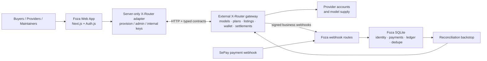

# Foza × X-Router

[🇬🇧 English](README.md) · [🇻🇳 Tiếng Việt](README.vi.md)

## The open control plane for a multi-provider AI marketplace

> **Public beta · Active development · Built for open-source maintainers**

Foza is the web and control plane around [X-Router](https://github.com/daokimluc/X-Router), an OpenAI-compatible gateway and model marketplace. It gives developers one place to discover model supply, create and manage API keys, connect models to keys, manage plans and wallets, buy prepaid token packs, and monitor usage and settlement data.

> This repository contains the Foza web/control plane, not the complete X-Router gateway runtime. The two systems communicate over HTTP through a server-only integration layer.

[](#project-status)
[](https://nextjs.org/)
[](https://www.typescriptlang.org/)

## Why this exists

AI developers increasingly work across providers, model families, coding tools, API keys, pricing schemes, and operational dashboards. For a small team or open-source maintainer, the difficult part is not only calling a model—it is keeping identity, access, cost, provider supply, payment, settlement, and observability coherent as the system grows.

Foza is designed to make that operational layer understandable and manageable. X-Router remains the gateway and catalog authority; Foza gives buyers, providers, and maintainers the product surfaces and durable coordination state around it.

## What is implemented today

### A working marketplace

The console marketplace reads listings, pricing inputs, markup, and per-listing metrics from X-Router when live integration is enabled. Buyers can connect a model to an existing API key or create a new key, and start a prepaid token-pack purchase from an enabled listing.

Metrics preserve distinct time horizons: settlement-window requests/tokens, lifetime success rate, and rolling five-minute latency/RPS. Missing data is rendered as `—` instead of being invented. The current search and filter controls are presentational UI; they do not yet implement client-side filtering.

### Buyer workflows

- Create, disable, enable, revoke, and rotate API keys.
- Connect marketplace models to buyer keys.
- Subscribe to plans with wallet-backed charging and optional overage.
- Cancel plans and manage wallet balance.
- Start bank-transfer top-ups through VietQR/SePay; wallet credit happens only after a verified payment webhook.
- Buy 1M, 5M, or 10M-token prepaid packs. The server recomputes price from the live listing and markup; client-supplied prices are not trusted.
- View usage totals and per-model request/token/spend breakdowns for the signed-in user's keys.

### Provider and admin workflows

Providers can register, wait for approval, and create model listings with cost pricing and provider-account references. Listing mutations are owner-scoped: seller identity is resolved server-side, and enable/disable/delete actions re-check ownership.

Admins and moderators have server-side permission gates for seller moderation, catalog controls, markup, plans, webhook configuration, roles, and platform-owned (“house”) listings. Seller earnings summary reads from X-Router; detailed provider-log rows are not populated yet.

### Money, events, and reconciliation

Foza keeps the state it owns in SQLite: user/resource mappings, payment intents, webhook event records, billing rows, payable rows, payout idempotency records, and reconciliation checkpoints.

The money ledger stores integer micro-USD values and uses settlement IDs as idempotency keys. Signed X-Router webhooks feed usage, quota, wallet, plan, supply, and reversal events into the local mirror. A periodic reconciliation sweep replays settlement records and reversals as a backstop for missed webhooks.

SePay handling authenticates the callback, matches a pending payment by transfer memo, verifies the amount, claims the payment row with a single-winner transition, credits X-Router, and finalizes only after the gateway call succeeds. Transient failures are released for retry; permanent failures are parked for manual reconciliation.

## Architecture



X-Router is an external service. Foza owns the web app, identity, console, payment coordination, webhook ingestion, and SQLite mirror ledger; X-Router owns the gateway, catalog, provisioning, and settlement APIs.

## Security and reliability boundaries

- X-Router provision, admin, internal, webhook, payment, and Auth.js secrets are environment-driven and server-only.
- The browser does not import the X-Router adapter or receive admin/provision secrets.
- Buyer keys are stored locally in masked form.
- X-Router webhooks use HMAC-SHA256 over the exact raw body and durable event deduplication.
- SePay callbacks use authenticated headers and constant-time comparison.
- User-controlled key, seller, and listing IDs are checked against durable ownership mappings before mutations.
- Read paths can fall back to typed mock/empty data when integration is disabled or unavailable. Provision/admin writes surface typed gateway errors instead of silently pretending success.

Remaining operational work is explicit: transient edge signals are in memory, some payment crash states require manual reconciliation, settlement reconciliation currently reads up to 1,000 rows per query, and the live aggregate adapter does not provide a measured average latency.

## Development setup

### Requirements

- Node.js compatible with the repository's Next.js 16 setup
- An X-Router service for live integration (optional for local mock mode)

### Run locally

```bash
npm install
copy .env.example .env.local
npm run dev
```

Open [http://localhost:3000](http://localhost:3000).

For local UI development, leave `MARKETPLACE_ENABLED=false`. The adapter uses deterministic typed fixtures and does not require an X-Router process.

For live integration, configure server-only keys and set:

```dotenv
MARKETPLACE_ENABLED=true
XROUTER_URL=http://localhost:3100
XROUTER_PROVISION_KEY=your-provision-key
XROUTER_ADMIN_KEY=your-admin-key
XROUTER_INTERNAL_KEY=your-internal-key
XROUTER_WEBHOOK_SECRET=your-webhook-secret
```

`XROUTER_ENABLED=true` is also accepted as a compatibility alias. Never commit `.env.local` or real credentials.

### Available scripts

```bash
npm run dev      # development server
npm run build    # production build
npm run start    # start production server
npm run lint     # ESLint
```

## Designed-for capacity targets

These figures are capacity-planning targets and product ambition—not verified production usage or current measured performance:

| Target | Meaning |
| --- | --- |
| `120M+ requests` | Future request-volume design target |
| `150+ models` | Future catalog breadth target |
| `30+ providers` | Future provider-network target |
| `<2000ms` | Future latency target, not an observed SLO |

## How Codex support would create leverage

Codex for Open Source support would be used against concrete maintainer bottlenecks, with security and correctness first:

1. **Security, reliability, and observability** — expand regression coverage around signed webhooks, payment claim/finalize/retry, settlement reversal, ownership, and reconciliation; harden the X-Router boundary and clarify fallback/data freshness.
2. **Maintainer automation** — triage issues/PRs, perform repository-aware review, generate regression tests, maintain release checklists, and detect documentation drift.
3. **Gateway and marketplace expansion** — improve provider approval synchronization, complete earnings detail and marketplace discovery/filtering, and extend provider/model coverage without weakening ownership or settlement boundaries.

The goal is not to replace maintainers. It is to give a small open-source team more reliable engineering capacity while keeping changes reviewable and money/security paths explicit.

## Roadmap

- **Now:** public-beta hardening, internal-user feedback, live-integration reliability, and payment/settlement correctness.
- **Next:** seller approval synchronization, provider earnings detail, marketplace discovery/filtering, clearer live/fallback indicators, and stronger automated regression coverage.
- **Later:** broader provider coverage, richer routing policies, maintainer automation, and a larger operational surface for open-source deployments.

## Project status

Foza is in public beta and active development. A small group of internal users is exercising the product. Capacity figures and dashboard fixtures are design/demo data unless explicitly identified as live data from X-Router or the Foza ledger.

## Scope and limitations

- This repository is not the complete X-Router gateway and does not implement `/v1/chat/completions`.
- Model subscription connects a model to a buyer key; it is not a separate listing purchase or settlement transaction.
- Search/filter controls are currently presentational.
- Provider earnings summary exists, but detailed provider-log rows are not populated.
- Seller approval is not visibly synchronized back into Foza's local seller status after the admin action.
- Some admin adapter capabilities are not exposed through complete visible UI flows.
- Plan cancellation clears the plan binding but does not claim automatic key disable/revocation.
- Do not interpret seeded fixtures, marketing cards, target figures, fallback data, or zero/empty reads as production telemetry.

## Contributing

Contributions are welcome. Before opening a pull request:

1. Read the relevant code and OpenSpec documents.
2. Keep X-Router secrets and `.env.local` out of commits.
3. Preserve server-only boundaries and ownership checks.
4. Add or update regression coverage for money, webhook, auth, and permission changes.
5. Run the available checks:

   ```bash
   npm run lint
   npm run build
   ```

Please describe whether a change affects mock mode, live X-Router mode, or both.

## Security

Please do not disclose vulnerabilities in public issues. Report them privately to maintainers with reproduction steps, affected paths, and deployment context. Never include real API keys, webhook secrets, bank credentials, or `.env.local` contents.

## License and program context

This project is shared as an open-source work in progress. Add or confirm the repository's formal license before publishing a release that depends on license metadata.

We are applying to [Codex for Open Source](https://developers.openai.com/community/codex-for-oss), a program for eligible open-source maintainers that may provide ChatGPT Pro with Codex, conditional Codex Security access, and API credits. Participation or acceptance should not be inferred from this README.

## Useful paths

- `src/app/[locale]/console/marketplace/` — buyer marketplace UI and actions
- `src/app/[locale]/console/provider/` — seller registration and listing creation
- `src/app/[locale]/console/admin/` — moderation and admin controls
- `src/lib/xrouter/adapter.ts` — server-side integration seam
- `src/lib/xrouter/client.ts` — authenticated HTTP client and retry behavior
- `src/lib/xrouter/ledger.ts` — durable money mirror and usage summaries
- `src/lib/xrouter/reconcile.ts` — settlement/reversal reconciliation
- `src/app/api/webhooks/xrouter/route.ts` — signed X-Router webhooks
- `src/app/api/webhooks/sepay/route.ts` — payment callback and crediting
- `openspec/` — product and integration specifications
