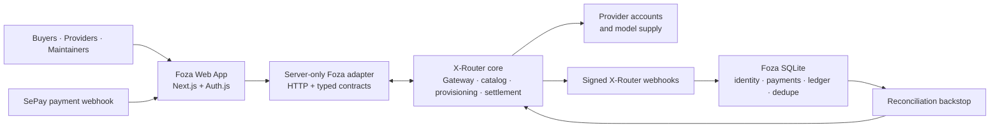

<p align="center">
  
</p>

<h1 align="center">X-Router</h1>

<p align="center">
  <strong>One endpoint for every AI provider.</strong><br/>
  Self-hosted AI gateway with multi-account pooling, auto-fallback, spending caps,
  response caching, and a full control-plane dashboard.
</p>

<p align="center">
  <a href="https://www.npmjs.com/package/@daokimluc/x-router"></a>
  <a href="LICENSE"></a>
  =22" />
</p>

<p align="center">
  Connect <strong>Claude Code, Cursor, Cline, Codex, Kiro, Windsurf, Aider</strong> and any
  OpenAI- or Anthropic-compatible tool to <strong>50+ providers</strong> through a single local URL.
</p>

<p align="center">
  <strong>English</strong> · <a href="docs/README.vi.md">Tiếng Việt</a>
</p>

---

## Why X-Router?

Running AI coding tools across many providers is messy: every tool wants its own
API key, subscriptions hit rate limits, accounts sit idle, and you have no idea
where the money goes. X-Router puts a single smart proxy in front of everything.

- **One endpoint, every tool** — point Cursor, Cline, Claude Code, Codex at one URL.
- **Multi-account pooling** — round-robin across N accounts per provider to multiply throughput.
- **Auto-fallback** — provider down or rate-limited? The next candidate is tried instantly.
- **Spend control** — hard daily/monthly USD caps per key and per team, enforced before the call.
- **Token savings** — optional Token Saver compresses tool output before it hits the provider.
- **Response cache** — identical requests return instantly at zero token cost (opt-in).
- **Full observability** — latency p50/p95/p99, usage charts, request logs, Prometheus `/metrics`.
- **Web dashboard** — manage providers, accounts, keys, routes, teams, and pricing from a browser.

---

## Quick Start

### Foza control plane / Control plane Foza

> **Public beta · Active development · Built for open-source maintainers**
>
> **Public beta · Đang phát triển · Xây dựng cho maintainer mã nguồn mở**

This repository now contains both the X-Router gateway core and the Foza web/control
plane under [`apps/foza/`](apps/foza/). Foza is the product and operations layer around
X-Router: it gives buyers, providers, and maintainers one place to discover model
supply, manage API keys, connect models to keys, manage plans and wallets, buy prepaid
token packs, and monitor usage and settlement data.

Repository này hiện bao gồm cả X-Router gateway core và Foza web/control plane tại
[`apps/foza/`](apps/foza/). Foza là lớp sản phẩm và vận hành bao quanh X-Router: buyer,
provider và maintainer có một nơi thống nhất để khám phá nguồn cung model, quản lý API
key, kết nối model vào key, quản lý plan và wallet, mua gói token trả trước, theo dõi
usage và settlement.

#### What Foza provides / Foza cung cấp

**English**

- **Working marketplace:** live listings, pricing, markup, and per-listing metrics from
  X-Router when integration is enabled; buyers can connect models to existing or new keys
  and start prepaid token-pack purchases.
- **Buyer workflows:** create, disable, enable, revoke, and rotate keys; subscribe to
  wallet-backed plans; manage wallet balance; start VietQR/SePay top-ups; buy 1M, 5M,
  or 10M token packs; and inspect usage by key and model.
- **Provider and admin workflows:** provider registration and model listings with
  owner-scoped mutations; server-side gates for seller moderation, catalog controls,
  markup, plans, roles, webhook configuration, and platform-owned listings.
- **Money and reliability:** SQLite state for identity mappings, payments, billing,
  payables, payout idempotency, and reconciliation checkpoints; integer micro-USD ledger
  values; signed X-Router webhooks; SePay verification; and reconciliation backstops.

**Tiếng Việt**

- **Marketplace đang hoạt động:** listing, giá, markup và metrics theo listing được đọc
  từ X-Router khi bật live integration; buyer có thể kết nối model vào key hiện có hoặc
  tạo key mới và bắt đầu mua gói token trả trước.
- **Luồng buyer:** tạo, tắt, bật lại, thu hồi và xoay vòng key; đăng ký plan tính phí từ
  wallet; quản lý số dư; nạp tiền qua VietQR/SePay; mua gói 1M, 5M hoặc 10M token; và
  xem usage theo key/model.
- **Luồng provider và admin:** provider đăng ký và tạo listing model với mutation giới
  hạn theo owner; server-side permission cho seller moderation, catalog, markup, plan,
  role, webhook và listing thuộc platform.
- **Money và reliability:** SQLite lưu mapping identity, payment, billing, payable,
  payout idempotency và reconciliation checkpoint; ledger dùng micro-USD nguyên; webhook
  X-Router có chữ ký; SePay được xác thực; có reconciliation backstop.

#### Architecture / Kiến trúc



X-Router core remains the gateway, catalog, provisioning, and settlement authority.
Foza owns the web app, identity, buyer/provider/admin console, payment coordination,
webhook ingestion, and local SQLite mirror ledger. Foza calls the core over HTTP through
server-only `/provision/*`, `/admin/v1/*`, and `/v1/*` integration paths; it does not
contain a second gateway runtime.

X-Router core vẫn là nơi sở hữu gateway, catalog, provisioning và settlement. Foza sở
hữu web app, identity, console buyer/provider/admin, payment coordination, webhook
ingestion và SQLite mirror ledger. Foza gọi core qua HTTP thông qua các path server-only
`/provision/*`, `/admin/v1/*` và `/v1/*`; Foza không chứa một gateway runtime thứ hai.

#### Run both applications / Chạy cả hai ứng dụng

Start X-Router first, then Foza in a second terminal:

```bash
# Terminal 1 — X-Router core
npm install
npm run build:all
ADMIN_API_KEYS=admin npm start

# Terminal 2 — Foza control plane
cd apps/foza
npm install
copy .env.example .env.local   # PowerShell / Windows
npm run dev
```

Foza expects `XROUTER_URL=http://localhost:3100`. For local UI work, leave
`MARKETPLACE_ENABLED=false` and use deterministic typed mock fixtures. For live
integration, set the server-only values below in `apps/foza/.env.local`:

```dotenv
MARKETPLACE_ENABLED=true
XROUTER_URL=http://localhost:3100
XROUTER_PROVISION_KEY=your-provision-key
XROUTER_ADMIN_KEY=your-admin-key
XROUTER_INTERNAL_KEY=your-internal-key
XROUTER_WEBHOOK_SECRET=your-webhook-secret
```

Never commit `.env.local`, real credentials, payment secrets, or webhook secrets.

#### Security, status, and roadmap / Bảo mật, trạng thái và roadmap

Foza keeps X-Router and Auth.js secrets server-only, masks buyer keys, verifies signed
webhooks with HMAC-SHA256, authenticates SePay callbacks with constant-time comparison,
and re-checks ownership before key, seller, or listing mutations. Read paths can fall
back to typed mock/empty data when integration is unavailable; writes return typed
gateway errors instead of pretending success.

Foza giữ secret X-Router và Auth.js ở server, mask buyer key, xác thực webhook bằng
HMAC-SHA256, xác thực callback SePay bằng constant-time comparison và kiểm tra ownership
trước mutation key/seller/listing. Read path có thể fallback về mock/empty data khi
integration không khả dụng; write trả typed gateway error thay vì giả vờ thành công.

Foza is in public beta and active development, with a small group of internal users.
The immediate roadmap is public-beta hardening, live-integration reliability, payment
and settlement correctness, seller approval synchronization, provider earnings detail,
marketplace discovery/filtering, clearer live/fallback indicators, and stronger
regression coverage. Seeded fixtures, marketing cards, capacity targets, and fallback
data are not production telemetry.

Foza đang ở public beta và được phát triển tích cực, với một nhóm nhỏ người dùng nội
bộ. Roadmap gần là hardening public beta, reliability của live integration, correctness
của payment/settlement, đồng bộ seller approval, provider earnings detail, marketplace
discovery/filtering, live/fallback indicator rõ hơn và regression coverage mạnh hơn.
Fixture, marketing card, capacity target và fallback data không phải production telemetry.

#### Codex for Open Source / Codex cho mã nguồn mở

Codex support would be applied to concrete maintainer bottlenecks: security and
reliability regression coverage around signed webhooks, payments, reversals, ownership,
and reconciliation; repository-aware issue/PR triage and review; documentation-drift
detection; and gateway/marketplace expansion without weakening money or security
boundaries. The project is in public beta and this application does not imply acceptance
into the program.

Hỗ trợ từ Codex sẽ tập trung vào các điểm nghẽn cụ thể của maintainer: regression
coverage cho webhook có chữ ký, payment, reversal, ownership và reconciliation; triage
issue/PR có context repository; phát hiện documentation drift; và mở rộng
gateway/marketplace mà không làm yếu ranh giới money/security. Dự án đang ở public beta
và việc đăng ký này không có nghĩa là đã được chấp nhận vào chương trình.

See the detailed [Foza English README](apps/foza/README.md) and
[Foza Vietnamese README](apps/foza/README.vi.md) for the full implementation status,
limitations, scripts, contribution guidance, and useful paths.

### npm (fastest)

```bash
npm install -g @daokimluc/x-router
x-router
```

That's it. The CLI:

1. Generates a default admin key (`admin`) on first run.
2. Starts the gateway on `http://localhost:3100`.
3. Opens the dashboard and shows an interactive menu.

Log into the dashboard with the admin key, then add a provider and create client
API keys from the **Endpoint & Keys** tab.

### Docker

```bash
docker run -p 3100:3100 \
  -e ADMIN_API_KEYS="your-admin-key" \
  ghcr.io/daokimluc/x-router:latest
```

Open `http://localhost:3100/` and log in with your admin key.

### From source

```bash
git clone https://github.com/daokimluc/X-Router.git
cd X-Router
npm install
npm run build:all
ADMIN_API_KEYS=admin npm start
```

---

## How It Works

```
  Your tools (Cursor · Cline · Claude Code · Codex · Aider · any SDK)
        │
        │  http://localhost:3100/v1   (OpenAI-compatible)
        │  http://localhost:3100      (Anthropic-compatible)
        ▼
  ┌───────────────────────────────────────────────────────────┐
  │                       X-Router                            │
  │                                                           │
  │   Auth ─▶ Spend cap ─▶ Cache ─▶ Resolve model ─▶ Pick    │
  │   key      check        lookup    → channel       account │
  │                                                  (pool)   │
  │                                                     │     │
  │   Token Saver · Latency tracking · Usage logging    │     │
  └─────────────────────────────────────────────────────┼─────┘
                                                         ▼
        ┌────────────────────┬────────────────────┬──────────────┐
        ▼                    ▼                    ▼              ▼
   OAuth subs          Cheap APIs            Free tier      Cloud
   (Claude Code,       (DeepSeek, GLM,       (Kiro,         (Vertex,
    Codex, Copilot)     MiniMax, Groq)        OpenCode)      Bedrock)
```

A request enters, gets authenticated against an API key, checked against spend
caps, looked up in the response cache, then resolved to a **channel** (a
provider instance serving a public model). The account pool picks the least-busy
account, the request is forwarded, and the response streams back — with usage,
latency, and cost recorded along the way. If a channel fails or is rate-limited,
the next candidate for the same model is tried automatically.

---

## Features

### Routing & reliability

- **Multi-channel routing** — the same public model name (e.g. `claude-opus-4-7`) can be served by several provider channels. The resolver collects all of them, sorts by priority, and fails over automatically.
- **Model name variants** — clients can send `claude-opus-4-7`, `claude-opus-4.7`, `claude-opus-4-7-20250101`, or Bedrock/Vertex-style names; the gateway normalizes them and reformats per provider.
- **Account pooling** — round-robin, least-busy, weighted, or priority strategies across N accounts per channel.
- **Circuit breaker** — auto-disable a channel after N consecutive failures, with a half-open probe to detect recovery.
- **Inline auth refresh** — OAuth/refresh-token credentials are refreshed on `401` and the request is retried, then written back so later requests reuse the new token.
- **Per-account proxy** — bind individual accounts to HTTP or Vercel-relay proxy pools.

### Cost control

- **Spending caps** — hard daily and monthly USD limits per API key and per team, enforced *before* the upstream call (hold-and-settle). Exceeding returns `429 spend_limit_exceeded`.
- **Token Saver** — compresses `tool_result` blocks (and optionally LLM output) before forwarding, cutting 20–40% of tokens on tool-heavy agent loops.
- **Response cache** — opt-in per request (`cache_control: { mode: "use" }`). Identical (model + messages + params) requests return cached completions at zero cost. LRU + TTL, bounded by entry count and bytes.
- **Per-key balance & quota** — optional credit balance, requests/minute, requests/day, tokens/day.

### Observability

- **Usage charts** — time-bucketed Trend / Proportion / Top views with a cost/tokens/requests switcher.
- **Latency tracking** — p50/p95/p99 per (channel × model × account) over a rolling 5-minute window.
- **Prometheus exporter** — `GET /metrics` with request and latency histograms for Grafana/Datadog.
- **Request logs & audit logs** — metadata-only request stream plus a full admin control-plane activity log.

### Management

- **Web dashboard** — providers, accounts, channels, models, routes, teams, pricing, keys — all from the browser.
- **Channel quick-create wizard** — create a provider instance + N accounts + M model mappings + overrides in one form.
- **Per-channel overrides** — `paramOverride` (force body params), `headerOverride` (inject headers), `statusCodeMapping` (retry/disable/passthrough), `maxInputTokens`, `systemPromptOverride`.
- **Teams** — group keys, share quotas, restrict allowed models/providers.
- **API key policies** — expiry, IP allowlist, model whitelist, group routing, cache mode, spend caps.

---

## Supported Providers

50+ provider types across categories. A few highlights:

| Category | Providers |
|---|---|
| **OAuth subscription** | Claude Code, Codex, GitHub Copilot, Cursor, Gemini CLI, Qwen, iFlow |
| **Free tier** | Kiro, OpenCode Free |
| **Cheap API** | DeepSeek, GLM (Zhipu), MiniMax, Groq, Cerebras, Together, Fireworks, OpenRouter, SiliconFlow, Nebius, Hyperbolic, Chutes, Mistral, Cohere, Moonshot/Kimi, xAI/Grok, and more |
| **Premium API** | OpenAI, Anthropic, Gemini, Alibaba (Qwen), ByteDance/Volcengine, Perplexity |
| **Cloud platform** | Vertex AI, Azure OpenAI, Cloudflare AI |
| **Custom** | Any OpenAI-compatible (`custom_openai`) or no-auth endpoint |

Each provider type ships with sensible defaults (base URL, paths, auth method).
Add accounts to a provider, and it becomes a routable channel.

---

## Client Setup

X-Router speaks two protocols on the same port:

| Your tool | Base URL | Auth |
|---|---|---|
| OpenAI-compatible (Cline, Continue, LiteLLM, Aider, LangChain) | `http://localhost:3100/v1` | `Authorization: Bearer <client-key>` |
| Anthropic-compatible (Claude Code, `@anthropic-ai/sdk`) | `http://localhost:3100` | `Authorization: Bearer <client-key>` or `x-api-key` |

Example (OpenAI SDK):

```python
from openai import OpenAI

client = OpenAI(
    base_url="http://localhost:3100/v1",
    api_key="your-client-key",   # created in the dashboard - Endpoint & Keys
)

resp = client.chat.completions.create(
    model="claude-opus-4-7",
    messages=[{"role": "user", "content": "Hello!"}],
)
print(resp.choices[0].message.content)
```

Enable the response cache for a request:

```jsonc
{
  "model": "claude-opus-4-7",
  "messages": [ /* ... */ ],
  "cache_control": { "mode": "use" }   // "skip" (default) | "use" | "refresh"
}
```

---

## Configuration

X-Router is configured at runtime through the dashboard. The only environment
variable you normally set is the admin key:

| Variable | Default | Purpose |
|---|---|---|
| `ADMIN_API_KEYS` | `admin` (dev) | Comma-separated keys to log into the dashboard and call `/admin/*`. Required in production. |
| `PORT` | `3100` | Listen port. |
| `HOST` | `0.0.0.0` | Bind host. |
| `DATA_FILE` | `data/gateway-state.json` | Where runtime state (providers, keys, usage) is persisted. |
| `LOG_LEVEL` | `info` | `fatal`/`error`/`warn`/`info`/`debug`/`trace`/`silent`. |
| `METRICS_PUBLIC` | `false` | When `true`, `/metrics` is reachable without auth. |

> Client API keys are **not** set via environment variables. Log into the
> dashboard with your admin key and create them under **Endpoint & Keys** —
> there you get per-key rate limits, model whitelists, IP allowlists, expiry,
> spend caps, and cache mode.

### CLI

```bash
x-router --port 3100          # start with interactive menu
x-router --no-menu            # foreground mode (Docker/systemd), logs to stdout
x-router --print-keys         # print the admin key and exit
x-router --help
```

Config and logs live in `~/.x-router/` (`config.json`, `server.log`).

---

## Admin API

All admin endpoints require `Authorization: Bearer <admin-key>` and live under
`/admin/v1`. Highlights:

| Area | Endpoints |
|---|---|
| Providers | `GET/POST /admin/v1/provider-instances`, `/channels/quick-create`, `/provider-instances/:id/test-model` |
| Accounts | `GET/POST /admin/v1/accounts`, `/accounts/:id/{enable,disable,test,reset-suspension}` |
| Models | `GET/POST/PATCH/DELETE /admin/v1/model-mappings`, `/sync-models/bulk` |
| API keys | `GET/POST/PATCH/DELETE /admin/v1/api-keys`, `/api-keys/:id/{reveal,enable,disable}` |
| Teams | `GET/POST/PATCH/DELETE /admin/v1/teams` |
| Spend | `GET /admin/v1/spend/{key,team}/:id` |
| Usage | `GET /admin/v1/usage`, `/usage/aggregate` |
| Metrics | `GET /admin/v1/metrics/latency`, `GET /metrics` (Prometheus) |
| Cache | `GET /admin/v1/cache/stats`, `DELETE /admin/v1/cache[/:prefix]` |
| Version | `GET /admin/v1/version` (current + latest + update check) |

---

## Development

```bash
# Gateway (Fastify + TypeScript) - hot reload
cd apps/gateway && npm install && npm run dev

# Dashboard (React + Vite)
cd apps/dashboard && npm install && npm run dev

# Run the test suite (443 tests)
cd apps/gateway && npx vitest run
```

Build everything for distribution:

```bash
npm run build:all   # builds dashboard-dist/ + dist/
```

---

## Tech Stack

- **Backend** — Node.js 22+, Fastify 5, TypeScript, Zod, undici, pino
- **Frontend** — React 19, Vite 7, Recharts, @xyflow/react, lucide-react
- **Persistence** — JSON state file (no external DB required)

---

## Acknowledgements

During development, X-Router drew inspiration from several excellent open-source
AI gateways such as [9Router](https://github.com/decolua/9router) and
[New API](https://github.com/QuantumNous/new-api). Many thanks to their authors
and communities.

X-Router is built on its own independent codebase (Fastify + TypeScript backend,
React dashboard) and does not reuse source code from these projects.

---

## License

MIT - Luc DK. See [LICENSE](LICENSE).
