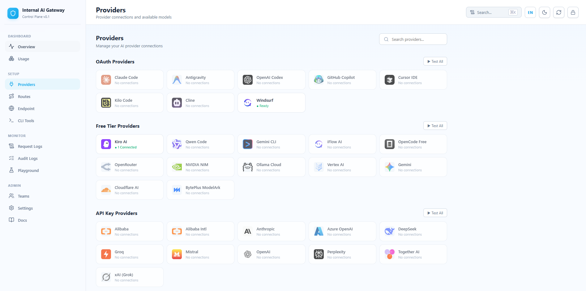

<p align="center">
  
</p>

# AI Gateway — Internal AI Router & Token Saver

> Never stop coding. Route requests across FREE & paid AI providers with auto-fallback, multi-account pooling, and 60-90% token savings.

Connect **Claude Code, Cursor, Cline, Kiro, Windsurf, Codex, OpenClaw, Antigravity** and any OpenAI-compatible tool to multiple AI providers through a single endpoint.

[](LICENSE)

[🚀 Quick Start](#-quick-start) • [💡 Features](#-key-features) • [📖 Setup](#-setup-guide) • [🏗️ Architecture](#️-architecture)

[🇻🇳 Tiếng Việt](docs/README.vi.md)

---

## 🤔 Why AI Gateway?

Stop wasting money, tokens and hitting limits:

- ❌ Subscription quota expires unused every month
- ❌ Rate limits stop you mid-coding
- ❌ Tool outputs (git diff, grep, ls...) burn tokens fast
- ❌ Manual switching between providers when one goes down
- ❌ No visibility into which accounts are healthy

**AI Gateway solves this:**

- ✅ **Token Saver** — Compress tool_result content (RTK), save 60-90% input tokens per request
- ✅ **Caveman Mode** — Terse-style output prompt, save up to 65% output tokens
- ✅ **Multi-account pooling** — Round-robin between accounts per provider
- ✅ **Auto fallback** — Route chains with priority order, zero downtime
- ✅ **Full dashboard** — Real-time monitoring, account health, usage analytics
- ✅ **Universal** — Works with any OpenAI/Anthropic-compatible CLI tool
- ✅ **Single process** — One command, one port, one container

---

## 🔄 How It Works

```
┌─────────────────┐
│  Your CLI Tool  │  (Claude Code, Cursor, Cline, Kiro, Windsurf, Codex...)
└────────┬────────┘
         │ http://localhost:3100/v1
         ▼
┌──────────────────────────────────────────────────┐
│              AI Gateway (localhost:3100)          │
│                                                  │
│  • Dashboard UI at /                             │
│  • API at /v1/chat/completions                   │
│  • Token Saver (RTK: -60-90% input tokens)       │
│  • Caveman Mode (-65% output tokens)             │
│  • Format translation (OpenAI ↔ Anthropic)       │
│  • Multi-account round-robin & load balancing    │
│  • Circuit breaker & auto-cooldown               │
│  • Request queue & backpressure                  │
└────────┬─────────────────────────────────────────┘
         │
         ├─→ Kiro AI (FREE Claude Sonnet 4.5)
         ├─→ Windsurf (FREE via Cascade)
         ├─→ OpenAI / Anthropic / Gemini (API Key)
         └─→ Any OpenAI-compatible endpoint

Result: Never stop coding. Minimal cost + massive token savings.
```

---

## ⚡ Quick Start

### Prerequisites

- Node.js 22+
- npm

### 1. Clone & Install

```bash
git clone https://github.com/daokimluc/AI-Gateway.git
cd AI-Gateway
npm install
```

### 2. Build

```bash
npm run build
```

### 3. Start Gateway

```bash
# Set required environment variables
export INTERNAL_API_KEYS="your-internal-key"
export ADMIN_API_KEYS="your-admin-password"

# Start (single process, single port)
node bin/ai-gateway.js
```

PowerShell (Windows):
```powershell
$env:INTERNAL_API_KEYS="your-internal-key"
$env:ADMIN_API_KEYS="your-admin-password"
node bin/ai-gateway.js
```

- 🌐 Dashboard + API: `http://localhost:3100`
- 🔌 API Endpoint: `http://localhost:3100/v1`
- 🔑 Admin password: value of `ADMIN_API_KEYS`

### 4. Add a Provider Account

Dashboard → Providers → Kiro/Windsurf → Add Account → Import from IDE (1 click)

### 5. Connect Your CLI Tool

```
Claude Code / Cursor / Cline Settings:
  API Provider: OpenAI Compatible
  Base URL:     http://localhost:3100/v1
  API Key:      [copy from Dashboard → Endpoint → API Keys]
  Model:        strong (or: kiro-sonnet, coding, fast, balanced)
```

That's it! Start coding with FREE AI models.

---

## 🐳 Docker

```bash
docker build -t ai-gateway .
docker run -p 3100:3100 \
  -e INTERNAL_API_KEYS="your-key" \
  -e ADMIN_API_KEYS="your-admin-password" \
  -v ./data:/app/data \
  ai-gateway
```

Single container, single port. No docker-compose needed.

---

## 🛠️ Supported CLI Tools

AI Gateway works seamlessly with all major AI coding tools:

| Tool | Status | Notes |
|------|--------|-------|
| Claude Code | ✅ | Full support |
| Cursor IDE | ✅ | Full support |
| Cline | ✅ | Full support |
| Kiro IDE | ✅ | Full support |
| Windsurf | ✅ | Full support |
| OpenAI Codex | ✅ | Full support |
| Antigravity | ✅ | Full support |
| OpenClaw | ✅ | Full support |
| Continue | ✅ | Full support |
| Any OpenAI-compatible | ✅ | Just point endpoint |

---

## 🌐 Supported Providers

### 🆓 Free Providers (Built-in Adapters)

| Provider | Models | Auth Method |
|----------|--------|-------------|
| **Kiro AI** | Claude Sonnet 4.5, GLM-5, MiniMax | OAuth / Local Import |
| **Windsurf** | Claude Sonnet 4.6 Thinking | OAuth / Local Import |

### 🔑 API Key Providers (Planned)

| Provider | Status |
|----------|--------|
| OpenAI | Roadmap |
| Anthropic | Roadmap |
| Google Gemini | Roadmap |
| DeepSeek | Roadmap |
| OpenRouter | Roadmap |
| Groq | Roadmap |

---

## 💡 Key Features

| Feature | Description | Savings |
|---------|-------------|---------|
| 🚀 **Token Saver (RTK)** | Compress tool outputs (git diff, grep, ls, tree...) before sending to LLM | 60-90% fewer input tokens |
| 🪨 **Caveman Mode** | Inject terse-mode system prompt → LLM replies concise | Up to 65% fewer output tokens |
| 🔄 **Multi-Account Pool** | Round-robin, weighted, least-busy account selection per provider | Load balancing + redundancy |
| 🎯 **Route Chains** | Priority-ordered model fallback | Zero downtime |
| ⚡ **Circuit Breaker** | Per-provider failure detection, auto-cooldown, half-open recovery | Auto-healing |
| 📊 **Real-Time Dashboard** | Provider health, request logs, usage analytics, audit trail | Full visibility |
| 🔐 **API Key Management** | Per-key rate limits, team quotas, enable/disable | Access control |
| 👥 **Teams & Quotas** | Group API keys, shared RPM/daily limits | Multi-tenant |
| 🔄 **Auto Token Refresh** | Provider sessions refresh automatically | No manual re-login |
| 📝 **Config Versioning** | Draft → Validate → Publish → Rollback | Safe changes |
| 🌐 **Dual Protocol** | OpenAI `/v1/chat/completions` + Anthropic `/v1/messages` | Universal compatibility |
| 🎨 **i18n Dashboard** | English + Vietnamese, switchable in real-time | Localized UX |
| 📦 **Single Package** | One process, one port, one container | Simple deployment |

---

## 📖 Setup Guide

### Adding Accounts

**Method 1: Import from IDE (Fastest)**

Dashboard → Providers → Select Provider → Add Account → "Nhập từ máy" tab → Click import

Works for Kiro (reads `~/.aws/sso/cache/`) and Windsurf (reads local SQLite DB).

**Method 2: Paste Token**

Dashboard → Providers → Select Provider → Add Account → "Token / Key" tab

For Windsurf: get token from [windsurf.com/show-auth-token](https://windsurf.com/show-auth-token)

**Method 3: OAuth (Windsurf)**

Dashboard → Providers → Windsurf → Add Account → "Ủy quyền OAuth" tab → Open browser → Login → Auto-created

### Creating Routes (Fallback Chains)

Dashboard → Routes → Create Route → Add models in priority order

Example:
```
Route: "coding"
  1. kiro-sonnet        (free, primary)
  2. windsurf-sonnet    (free, backup)
```

### Available Model IDs

Use these as `model` in your IDE configuration:

| Model ID | Description |
|----------|-------------|
| `strong` | Best quality (routes to kiro-sonnet) |
| `coding` | Optimized for code (kiro-sonnet → windsurf-sonnet fallback) |
| `fast` | Fastest response (windsurf-sonnet → kiro-sonnet fallback) |
| `balanced` | Balance of speed and quality |
| `kiro-sonnet` | Direct to Kiro provider |
| `windsurf-sonnet` | Direct to Windsurf provider |

### Token Saver Configuration

Dashboard → Endpoint → Token Saver section:
- **Compress tool output (RTK)**: ON — saves 60-90% on git/grep/ls/tree outputs
- **Compress LLM output (Caveman)**: Lite / Full / Ultra modes

### API Keys & Teams

Dashboard → Endpoint → API Keys → Create Key
- Assign to teams for shared quotas
- Set per-key RPM and daily limits

---

## 🏗️ Architecture

```
ai-gateway/                    # Single package
├── bin/
│   └── ai-gateway.js         # CLI entry point (npx ai-gateway)
├── dist/                      # Compiled gateway (TypeScript → JS)
├── dashboard-dist/            # Pre-built React dashboard (static files)
├── apps/
│   ├── gateway/               # Fastify API server source
│   │   ├── src/
│   │   │   ├── routes/        # Admin API + OAuth + Provider accounts
│   │   │   ├── providers/     # Provider adapter system
│   │   │   │   ├── adapters/
│   │   │   │   │   ├── kiro/      # Kiro (OAuth + refresh token)
│   │   │   │   │   └── windsurf/  # Windsurf (local LS + Cascade)
│   │   │   │   └── registry/      # ProviderAdapterRegistry
│   │   │   ├── plugins/      # Static file serving (dashboard)
│   │   │   └── services/     # Secret, Audit, Persistence, RateLimit
│   │   └── test/
│   └── dashboard/             # React SPA source
│       └── src/
│           ├── App.tsx        # Main dashboard
│           └── i18n.ts        # EN/VI translations
├── scripts/
│   └── build.mjs             # Build script (dashboard + gateway)
├── Dockerfile                 # Multi-stage (3 stages, non-root user)
└── package.json               # Single package config
```

### Tech Stack

| Layer | Technology |
|-------|-----------|
| Runtime | Node.js 22+ / TypeScript 5.6 |
| Gateway | Fastify 5 + @fastify/static |
| Dashboard | React 19 + Vite 7 |
| Static Serving | Dashboard built into gateway process |
| Storage | JSON file persistence |
| Auth | Bearer token + AES-256-GCM credential encryption |
| Streaming | Server-Sent Events (SSE) |
| Container | node:22-alpine, non-root user, healthcheck |

---

## 📝 API Reference

### Chat Completions (OpenAI-compatible)

```http
POST http://localhost:3100/v1/chat/completions
Authorization: Bearer <your-api-key>
Content-Type: application/json

{
  "model": "strong",
  "messages": [
    {"role": "user", "content": "Write a function to sort an array"}
  ],
  "stream": true
}
```

### List Models

```http
GET http://localhost:3100/v1/models
Authorization: Bearer <your-api-key>
```

### Admin API

Full admin API at `/admin/v1/*` — accessible from the Dashboard docs page.

---

## ⚙️ CLI Options

```
Usage: ai-gateway [options]

Options:
  --port <number>  Port to listen on (default: 3100)
  --host <string>  Host to bind to (default: 0.0.0.0)
  --help           Show help message

Environment Variables (required):
  INTERNAL_API_KEYS   Comma-separated API keys for /v1 routes
  ADMIN_API_KEYS      Comma-separated API keys for /admin routes

Optional:
  DATA_FILE           Path to state file (default: data/gateway-state.json)
  NODE_ENV            development | production (default: development)
  LOG_LEVEL           info | debug | warn | error (default: info)
```

---

## 🐛 Troubleshooting

| Problem | Solution |
|---------|----------|
| "invalid api key" on test | Token expired → Re-import from IDE or get new token |
| "daily usage quota exhausted" | Account quota used up → Wait for reset or add another account |
| "Kiro local token not found" | Login to Kiro IDE first, then retry import |
| "Port 3100 is already in use" | Kill existing process or use `--port 3101` |
| Rate limited | Add more accounts to the pool for round-robin |
| Model ID not found | Use lowercase: `strong`, `coding`, `fast` (not `Strong`) |

---

## 🗺️ Roadmap

- [x] Kiro provider adapter (OAuth + refresh token)
- [x] Windsurf provider adapter (local LS + Cascade gRPC)
- [x] Multi-account pool with round-robin
- [x] Route chains with fallback
- [x] Token Saver (RTK compression)
- [x] Caveman Mode (output compression)
- [x] Dashboard with full admin control
- [x] i18n (English + Vietnamese)
- [x] API key management with team quotas
- [x] Circuit breaker per provider
- [x] Single package deployment (one port, one process)
- [x] Multi-stage Dockerfile
- [x] CLI entry point with flag parsing
- [ ] OpenAI provider adapter
- [ ] Anthropic provider adapter
- [ ] OpenRouter provider adapter
- [ ] Gemini provider adapter
- [ ] Cloudflare Tunnel integration
- [ ] Docker Hub image
- [ ] npm publish (npx ai-gateway)

---

## 🙏 Acknowledgments

Built on the shoulders of giants:

- [RTK](https://github.com/rtk-ai/rtk) — Rust token-saver. Gateway ports its compression pipeline to TypeScript → 60-90% fewer input tokens.
- [Caveman](https://github.com/JuliusBrussee/caveman) by [@JuliusBrussee](https://github.com/JuliusBrussee) — "why use many token when few token do trick". Gateway adapts its prompt → up to 65% fewer output tokens.
- [WindsurfAPI](https://github.com/dwgx/WindsurfAPI) — Reference implementation for Windsurf Cascade protocol. Windsurf adapter derived from this work (MIT).

---

## 📄 License

MIT License — see [LICENSE](LICENSE) for details.

---

<p align="center">
  Built with ❤️ for developers who code 24/7
</p>
