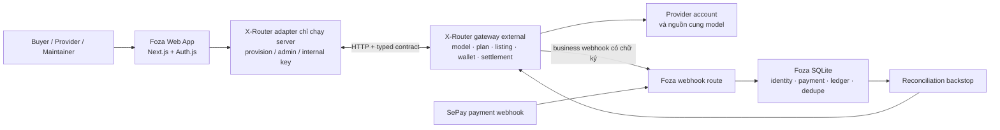

# Foza × X-Router

[🇬🇧 English](README.md) · [🇻🇳 Tiếng Việt](README.vi.md)

## Control plane mở cho AI marketplace nhiều provider

> **Public beta · Đang phát triển · Xây dựng cho maintainer mã nguồn mở**

Foza là lớp web và control plane bao quanh [X-Router](https://github.com/daokimluc/X-Router) — gateway tương thích OpenAI và marketplace cho nhiều model/provider. Foza cung cấp một nơi thống nhất để khám phá model, quản lý API key, kết nối model vào key, quản lý plan và wallet, mua gói token trả trước, đồng thời theo dõi usage và settlement.

> Repository này chứa web/control plane Foza, không chứa toàn bộ runtime gateway X-Router. Hai hệ thống giao tiếp qua HTTP thông qua lớp tích hợp chỉ chạy ở server.

[](#trạng-thái-dự-án)

## Vì sao dự án này tồn tại

Developer AI ngày càng phải làm việc với nhiều provider, model family, coding tool, API key, bảng giá và dashboard vận hành. Với một nhóm nhỏ hoặc maintainer open source, bài toán khó không chỉ là gọi model — mà còn là giữ identity, quyền truy cập, chi phí, nguồn cung provider, thanh toán, settlement và observability nhất quán khi hệ thống mở rộng.

Foza được thiết kế để làm cho lớp vận hành đó dễ hiểu và dễ quản lý hơn. X-Router vẫn là nơi sở hữu gateway và catalog; Foza cung cấp các giao diện sản phẩm cùng coordination state bền vững cho buyer, provider và maintainer.

## Những gì đã triển khai

### Marketplace đang hoạt động

Marketplace trong console đọc listing, giá vốn, markup và metrics theo từng listing từ X-Router khi bật live integration. Buyer có thể kết nối model vào API key hiện có hoặc tạo key mới, đồng thời bắt đầu mua gói token trả trước từ listing đang bật.

Metrics phân biệt các khoảng thời gian: request/token trong settlement window, success rate theo lifetime và latency/RPS trong rolling window 5 phút. Dữ liệu thiếu được hiển thị là `—`, không bịa thành số 0 hoặc 100%. Các control search/filter hiện mới là UI, chưa thực hiện lọc phía client.

### Các luồng buyer

- Tạo, tắt, bật lại, thu hồi và xoay vòng API key.
- Kết nối model marketplace vào buyer key.
- Đăng ký plan với việc thu phí dựa trên wallet và tùy chọn overage.
- Hủy plan và quản lý số dư wallet.
- Tạo yêu cầu nạp tiền qua VietQR/SePay; wallet chỉ được cộng sau khi webhook thanh toán hợp lệ xác nhận.
- Mua gói token trả trước 1M, 5M hoặc 10M token. Server tự tính lại giá từ listing và markup live; không tin giá do client gửi lên.
- Xem tổng usage và breakdown request/token/chi phí theo model của các key thuộc user đang đăng nhập.

### Các luồng provider và admin

Provider có thể đăng ký, chờ duyệt và tạo listing model với giá vốn cùng thông tin provider account. Các mutation listing được giới hạn theo owner: seller identity được resolve ở server và các thao tác bật/tắt/xóa listing đều kiểm tra lại ownership.

Admin và moderator có permission gate ở server cho seller moderation, quản lý catalog, markup, plan, cấu hình webhook, role và listing thuộc platform (“house”). Phần tổng quan earnings của seller đọc từ X-Router; bảng chi tiết provider log hiện chưa được populate.

### Money, event và reconciliation

Foza lưu trong SQLite những state do mình sở hữu: mapping user/resource, payment intent, webhook event, billing row, payable row, payout idempotency và reconciliation checkpoint.

Money ledger lưu giá trị dạng micro-USD nguyên để tránh sai số float và dùng settlement ID làm idempotency key. Webhook X-Router có chữ ký đưa các event usage, quota, wallet, plan, supply và reversal vào local mirror. Một job reconciliation định kỳ replay settlement và reversal để backstop khi webhook bị lỡ.

Luồng SePay xác thực callback, tìm payment pending bằng memo chuyển khoản, kiểm tra số tiền, claim payment theo cơ chế single-winner, credit sang X-Router và chỉ finalize sau khi gateway trả thành công. Lỗi tạm thời được trả về pending để retry; lỗi vĩnh viễn được giữ lại để reconcile thủ công.

## Kiến trúc



X-Router là dịch vụ external. Foza sở hữu web app, identity, console, payment coordination, webhook ingestion và SQLite mirror ledger; X-Router sở hữu gateway, catalog, provisioning và settlement API.

## Ranh giới security và reliability

- Secret X-Router provision, admin, internal, webhook, payment và Auth.js được cấu hình qua environment và chỉ dùng ở server.
- Browser không import X-Router adapter và không nhận admin/provision secret.
- Buyer key chỉ được lưu local dưới dạng masked.
- Webhook X-Router dùng HMAC-SHA256 trên raw body và dedupe event bền vững.
- Callback SePay dùng header authentication và so sánh constant-time.
- Các key/seller/listing ID do user gửi lên được kiểm tra ownership trước khi mutation.
- Read path có thể fallback về mock/empty data khi integration tắt hoặc gateway unavailable. Provision/admin write trả typed gateway error thay vì giả vờ ghi thành công.

Các phần còn cần hoàn thiện cũng được ghi rõ: edge signal tạm thời đang ở memory, một số payment crash state cần reconcile thủ công, reconciliation hiện đọc tối đa 1.000 record mỗi query và live aggregate adapter chưa cung cấp average latency đo được.

## Thiết lập môi trường phát triển

### Yêu cầu

- Node.js tương thích với setup Next.js 16 của repository.
- Một X-Router service nếu muốn live integration; không bắt buộc khi chạy mock mode local.

### Chạy local

```bash
npm install
copy .env.example .env.local
npm run dev
```

Mở [http://localhost:3000](http://localhost:3000).

Để phát triển UI local, giữ `MARKETPLACE_ENABLED=false`. Adapter sẽ dùng fixture typed deterministic và không cần chạy X-Router.

Để live integration, cấu hình các key chỉ dùng ở server:

```dotenv
MARKETPLACE_ENABLED=true
XROUTER_URL=http://localhost:3100
XROUTER_PROVISION_KEY=your-provision-key
XROUTER_ADMIN_KEY=your-admin-key
XROUTER_INTERNAL_KEY=your-internal-key
XROUTER_WEBHOOK_SECRET=your-webhook-secret
```

`XROUTER_ENABLED=true` cũng được hỗ trợ như alias tương thích. Không commit `.env.local` hoặc credential thật.

### Các script hiện có

```bash
npm run dev      # development server
npm run build    # production build
npm run start    # start production server
npm run lint     # ESLint
```

## Mục tiêu capacity thiết kế

Các con số dưới đây là mục tiêu capacity và định hướng sản phẩm — không phải usage production đã xác minh hoặc performance hiện tại:

| Mục tiêu | Ý nghĩa |
| --- | --- |
| `120M+ requests` | Mục tiêu request trong tương lai |
| `150+ models` | Mục tiêu mở rộng catalog |
| `30+ providers` | Mục tiêu mở rộng provider |
| `<2000ms` | Mục tiêu latency, không phải SLO đã đo |

## Codex sẽ tạo thêm đòn bẩy như thế nào

Hỗ trợ từ Codex for Open Source sẽ được dùng cho các điểm nghẽn maintainer cụ thể, ưu tiên security và correctness:

1. **Security, reliability và observability** — mở rộng regression coverage cho webhook có chữ ký, payment claim/finalize/retry, settlement reversal, ownership và reconciliation; harden boundary với X-Router và làm rõ fallback/data freshness.
2. **Maintainer automation** — triage issue/PR, code review có context repo, tạo regression test, duy trì release checklist và phát hiện documentation drift.
3. **Mở rộng gateway và marketplace** — cải thiện provider approval synchronization, hoàn thiện earnings detail và marketplace discovery/filtering, mở rộng provider/model coverage mà không làm yếu ownership hoặc settlement boundary.

Mục tiêu không phải thay thế maintainer, mà là giúp một nhóm open-source nhỏ có thêm năng lực engineering đáng tin cậy trong khi thay đổi vẫn review được và các luồng money/security vẫn minh bạch.

## Roadmap

- **Hiện tại:** hardening public beta, feedback từ người dùng nội bộ, reliability của live integration và correctness của payment/settlement.
- **Tiếp theo:** đồng bộ seller approval, hoàn thiện provider earnings detail, marketplace discovery/filtering, live/fallback indicator rõ hơn và regression coverage tự động mạnh hơn.
- **Sau đó:** mở rộng provider coverage, routing policy, maintainer automation và operational surface cho deployment open-source lớn hơn.

## Trạng thái dự án

Foza đang ở public beta và được phát triển tích cực. Một nhóm nhỏ người dùng nội bộ đang sử dụng sản phẩm. Capacity figure và dashboard fixture là dữ liệu thiết kế/demo, trừ khi được xác định rõ là dữ liệu live từ X-Router hoặc Foza ledger.

## Phạm vi và giới hạn

- Repository này không chứa toàn bộ X-Router gateway và không có `/v1/chat/completions`.
- Model subscription chỉ kết nối model vào buyer key; không phải một giao dịch mua listing hoặc settlement riêng.
- Search/filter hiện mới là UI.
- Provider earnings summary đã có, nhưng provider-log detail chưa được populate.
- Seller approval chưa được hiển thị là đồng bộ ngược vào local seller status của Foza sau admin action.
- Một số capability trong adapter/admin chưa được expose qua UI đầy đủ.
- Plan cancellation xóa plan binding nhưng không tự động disable/revoke key.
- Không coi seeded fixture, marketing card, target figure, fallback data hoặc zero/empty read là production telemetry.

## Đóng góp

Chúng tôi hoan nghênh contribution. Trước khi mở pull request:

1. Đọc code và OpenSpec liên quan.
2. Không commit X-Router secret hoặc `.env.local`.
3. Giữ server-only boundary và ownership checks.
4. Bổ sung hoặc cập nhật regression coverage cho thay đổi money, webhook, auth và permission.
5. Chạy các check hiện có:

   ```bash
   npm run lint
   npm run build
   ```

Hãy ghi rõ thay đổi ảnh hưởng mock mode, live X-Router mode hay cả hai.

## Bảo mật

Không công khai lỗ hổng trong issue. Hãy gửi riêng cho maintainer cùng bước tái hiện, path bị ảnh hưởng và deployment context. Không gửi API key, webhook secret, thông tin ngân hàng hoặc nội dung `.env.local` thật.

## License và chương trình hỗ trợ

Đây là dự án open-source đang phát triển. Hãy bổ sung hoặc xác nhận license chính thức của repository trước khi phát hành release phụ thuộc vào license metadata.

Chúng tôi đăng ký [Codex for Open Source](https://developers.openai.com/community/codex-for-oss), chương trình hỗ trợ maintainer mã nguồn mở đủ điều kiện thông qua ChatGPT Pro với Codex, quyền truy cập Codex Security có điều kiện và API credits. README này không ngụ ý dự án đã được chấp nhận.

## Các path quan trọng

- `src/app/[locale]/console/marketplace/` — buyer marketplace UI và actions
- `src/app/[locale]/console/provider/` — seller registration và listing creation
- `src/app/[locale]/console/admin/` — moderation và admin controls
- `src/lib/xrouter/adapter.ts` — server-side integration seam
- `src/lib/xrouter/client.ts` — authenticated HTTP client và retry behavior
- `src/lib/xrouter/ledger.ts` — durable money mirror và usage summary
- `src/lib/xrouter/reconcile.ts` — settlement/reversal reconciliation
- `src/app/api/webhooks/xrouter/route.ts` — signed X-Router webhook
- `src/app/api/webhooks/sepay/route.ts` — payment callback và crediting flow
- `openspec/` — product và integration specification
