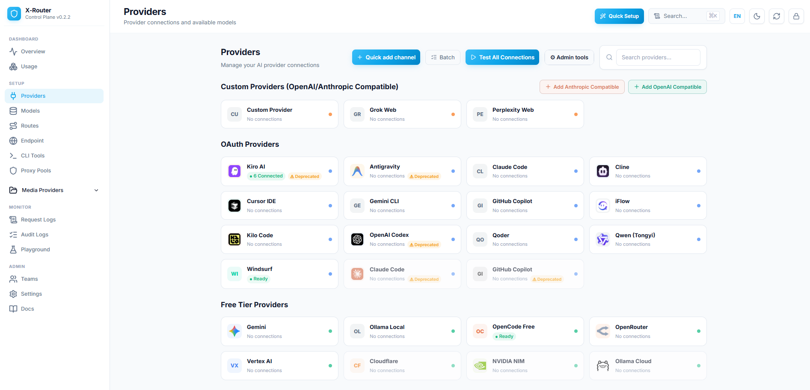

<p align="center">
  
</p>

<h1 align="center">X-Router</h1>

<p align="center">
  <strong>Một endpoint cho mọi nhà cung cấp AI.</strong><br/>
  AI gateway tự host với pool nhiều tài khoản, auto-fallback, hạn mức chi tiêu,
  cache phản hồi, và dashboard quản trị đầy đủ.
</p>

<p align="center">
  <a href="https://www.npmjs.com/package/@daokimluc/x-router"></a>
  <a href="../LICENSE"></a>
  =22" />
</p>

<p align="center">
  Kết nối <strong>Claude Code, Cursor, Cline, Codex, Kiro, Windsurf, Aider</strong> và mọi
  công cụ tương thích OpenAI hoặc Anthropic tới <strong>50+ nhà cung cấp</strong> qua một URL local duy nhất.
</p>

<p align="center">
  <a href="../README.md">English</a> · <strong>Tiếng Việt</strong>
</p>

---

## Tại sao chọn X-Router?

Dùng nhiều công cụ AI qua nhiều provider rất rối: mỗi công cụ đòi một API key
riêng, subscription dính rate limit, tài khoản nằm không, và bạn chẳng biết tiền
chảy đi đâu. X-Router đặt một proxy thông minh duy nhất đứng trước tất cả.

- **Một endpoint, mọi công cụ** — trỏ Cursor, Cline, Claude Code, Codex về cùng một URL.
- **Pool nhiều tài khoản** — round-robin qua N tài khoản mỗi provider để nhân throughput.
- **Auto-fallback** — provider lỗi hoặc bị rate limit? Ứng viên kế tiếp được thử ngay lập tức.
- **Kiểm soát chi tiêu** — hạn mức USD cứng theo ngày/tháng cho từng key và team, chặn trước khi gọi.
- **Tiết kiệm token** — Token Saver nén tool output trước khi gửi tới provider.
- **Cache phản hồi** — request trùng trả về tức thì, chi phí token bằng 0 (tuỳ chọn bật).
- **Giám sát đầy đủ** — latency p50/p95/p99, biểu đồ usage, request log, Prometheus `/metrics`.
- **Dashboard web** — quản lý provider, account, key, route, team, pricing ngay trên trình duyệt.

---

## Bắt đầu nhanh

### npm (nhanh nhất)

```bash
npm install -g @daokimluc/x-router
x-router
```

Xong. CLI sẽ:

1. Tạo admin key mặc định (`admin`) lần chạy đầu tiên.
2. Khởi động gateway tại `http://localhost:3100`.
3. Mở dashboard và hiện menu tương tác.

Đăng nhập dashboard bằng admin key, sau đó thêm provider và tạo client API key
trong tab **Endpoint & Keys**.

### Docker

```bash
docker run -p 3100:3100 \
  -e ADMIN_API_KEYS="khoa-admin-cua-ban" \
  ghcr.io/daokimluc/x-router:latest
```

Mở `http://localhost:3100/` và đăng nhập bằng admin key.

### Từ mã nguồn

```bash
git clone https://github.com/daokimluc/X-Router.git
cd X-Router
npm install
npm run build:all
ADMIN_API_KEYS=admin npm start
```


---

## Cách hoạt động

```
  Công cụ của bạn (Cursor · Cline · Claude Code · Codex · Aider · mọi SDK)
        │
        │  http://localhost:3100/v1   (tương thích OpenAI)
        │  http://localhost:3100      (tương thích Anthropic)
        ▼
  ┌───────────────────────────────────────────────────────────┐
  │                       X-Router                            │
  │                                                           │
  │   Auth ─▶ Kiểm tra ─▶ Tra ─▶ Resolve ─▶ Chọn tài khoản    │
  │   key     spend cap   cache   model      (pool)           │
  │                                            │              │
  │   Token Saver · Theo dõi latency · Ghi usage              │
  └────────────────────────────────────────────┼─────────────┘
                                                ▼
        ┌────────────────────┬────────────────────┬──────────────┐
        ▼                    ▼                    ▼              ▼
   OAuth sub           API giá rẻ            Free tier      Cloud
   (Claude Code,       (DeepSeek, GLM,       (Kiro,         (Vertex,
    Codex, Copilot)     MiniMax, Groq)        OpenCode)      Bedrock)
```

Một request đi vào, được xác thực bằng API key, kiểm tra hạn mức chi tiêu, tra
trong cache phản hồi, rồi resolve về một **channel** (provider instance phục vụ
một public model). Account pool chọn tài khoản ít bận nhất, request được chuyển
tiếp, và phản hồi stream trở lại — đồng thời ghi lại usage, latency, chi phí.
Nếu một channel lỗi hoặc bị rate limit, ứng viên kế tiếp cho cùng model được thử
tự động.

---

## Tính năng

### Định tuyến & độ tin cậy

- **Multi-channel routing** — cùng một tên public model (vd `claude-opus-4-7`) có thể được phục vụ bởi nhiều channel. Resolver gom tất cả, sắp theo priority, và fallback tự động.
- **Biến thể tên model** — client gửi `claude-opus-4-7`, `claude-opus-4.7`, `claude-opus-4-7-20250101`, hay tên kiểu Bedrock/Vertex đều được chuẩn hoá và format lại theo provider.
- **Account pooling** — chiến lược round-robin, least-busy, weighted, hoặc priority qua N tài khoản mỗi channel.
- **Circuit breaker** — tự tắt channel sau N lần lỗi liên tiếp, có probe half-open để phát hiện phục hồi.
- **Tự refresh auth** — credential OAuth/refresh-token được làm mới khi gặp `401` rồi retry, sau đó ghi lại để request sau dùng token mới.
- **Proxy theo tài khoản** — gắn từng tài khoản với proxy pool HTTP hoặc Vercel-relay.

### Kiểm soát chi phí

- **Hạn mức chi tiêu** — giới hạn USD cứng theo ngày và tháng cho từng key và team, chặn *trước khi* gọi provider (hold-and-settle). Vượt sẽ trả `429 spend_limit_exceeded`.
- **Token Saver** — nén khối `tool_result` (và tuỳ chọn cả output LLM) trước khi chuyển tiếp, cắt 20–40% token cho vòng lặp agent nhiều tool.
- **Cache phản hồi** — tuỳ chọn bật theo request (`cache_control: { mode: "use" }`). Request trùng (model + messages + tham số) trả về cached, chi phí 0. LRU + TTL, giới hạn theo số entry và dung lượng.
- **Balance & quota theo key** — tuỳ chọn số dư credit, request/phút, request/ngày, token/ngày.

### Giám sát

- **Biểu đồ usage** — các view Trend / Proportion / Top theo thời gian, đổi giữa chi phí/token/request.
- **Theo dõi latency** — p50/p95/p99 theo (channel × model × account) trong cửa sổ trượt 5 phút.
- **Prometheus exporter** — `GET /metrics` với histogram request và latency cho Grafana/Datadog.
- **Request log & audit log** — luồng metadata của request cộng với log đầy đủ hoạt động control-plane.

### Quản lý

- **Dashboard web** — provider, account, channel, model, route, team, pricing, key — tất cả trên trình duyệt.
- **Wizard tạo nhanh channel** — tạo provider instance + N account + M model mapping + override trong một form.
- **Override theo channel** — `paramOverride` (ép tham số body), `headerOverride` (chèn header), `statusCodeMapping` (retry/disable/passthrough), `maxInputTokens`, `systemPromptOverride`.
- **Teams** — gom key, chia sẻ quota, giới hạn model/provider được phép.
- **Chính sách API key** — hết hạn, IP allowlist, model whitelist, group routing, cache mode, spend cap.


---

## Nhà cung cấp được hỗ trợ

Hơn 50 loại provider theo nhóm. Một số tiêu biểu:

| Nhóm | Provider |
|---|---|
| **OAuth subscription** | Claude Code, Codex, GitHub Copilot, Cursor, Gemini CLI, Qwen, iFlow |
| **Free tier** | Kiro, OpenCode Free |
| **API giá rẻ** | DeepSeek, GLM (Zhipu), MiniMax, Groq, Cerebras, Together, Fireworks, OpenRouter, SiliconFlow, Nebius, Hyperbolic, Chutes, Mistral, Cohere, Moonshot/Kimi, xAI/Grok, và nhiều hơn nữa |
| **API premium** | OpenAI, Anthropic, Gemini, Alibaba (Qwen), ByteDance/Volcengine, Perplexity |
| **Cloud platform** | Vertex AI, Azure OpenAI, Cloudflare AI |
| **Tuỳ chỉnh** | Mọi endpoint tương thích OpenAI (`custom_openai`) hoặc không cần auth |

Mỗi loại provider đi kèm cấu hình mặc định hợp lý (base URL, path, auth method).
Thêm tài khoản vào provider, và nó trở thành channel có thể định tuyến.

---

## Cấu hình Client

X-Router nói hai protocol trên cùng một port:

| Công cụ | Base URL | Auth |
|---|---|---|
| Tương thích OpenAI (Cline, Continue, LiteLLM, Aider, LangChain) | `http://localhost:3100/v1` | `Authorization: Bearer <client-key>` |
| Tương thích Anthropic (Claude Code, `@anthropic-ai/sdk`) | `http://localhost:3100` | `Authorization: Bearer <client-key>` hoặc `x-api-key` |

Ví dụ (OpenAI SDK):

```python
from openai import OpenAI

client = OpenAI(
    base_url="http://localhost:3100/v1",
    api_key="client-key-cua-ban",   # tạo trong dashboard - Endpoint & Keys
)

resp = client.chat.completions.create(
    model="claude-opus-4-7",
    messages=[{"role": "user", "content": "Xin chào!"}],
)
print(resp.choices[0].message.content)
```

Bật cache phản hồi cho một request:

```jsonc
{
  "model": "claude-opus-4-7",
  "messages": [ /* ... */ ],
  "cache_control": { "mode": "use" }   // "skip" (mặc định) | "use" | "refresh"
}
```

---

## Biến môi trường

X-Router được cấu hình lúc chạy qua dashboard. Biến môi trường duy nhất bạn
thường cần đặt là admin key:

| Biến | Mặc định | Mục đích |
|---|---|---|
| `ADMIN_API_KEYS` | `admin` (dev) | Các key (phân tách bằng dấu phẩy) để đăng nhập dashboard và gọi `/admin/*`. Bắt buộc trong production. |
| `PORT` | `3100` | Port lắng nghe. |
| `HOST` | `0.0.0.0` | Host bind. |
| `DATA_FILE` | `data/gateway-state.json` | Nơi lưu state runtime (provider, key, usage). |
| `LOG_LEVEL` | `info` | `fatal`/`error`/`warn`/`info`/`debug`/`trace`/`silent`. |
| `METRICS_PUBLIC` | `false` | Khi `true`, `/metrics` truy cập được không cần auth. |

> Client API key **không** đặt qua biến môi trường. Đăng nhập dashboard bằng
> admin key và tạo chúng trong **Endpoint & Keys** — ở đó bạn có rate limit theo
> key, model whitelist, IP allowlist, hết hạn, spend cap, và cache mode.

### CLI

```bash
x-router --port 3100          # khởi động với menu tương tác
x-router --no-menu            # chế độ foreground (Docker/systemd), log ra stdout
x-router --print-keys         # in admin key rồi thoát
x-router --help
```

Cấu hình và log nằm ở `~/.x-router/` (`config.json`, `server.log`).

---

## Admin API

Mọi endpoint admin cần `Authorization: Bearer <admin-key>` và nằm dưới
`/admin/v1`. Tiêu biểu:

| Khu vực | Endpoint |
|---|---|
| Providers | `GET/POST /admin/v1/provider-instances`, `/channels/quick-create`, `/provider-instances/:id/test-model` |
| Accounts | `GET/POST /admin/v1/accounts`, `/accounts/:id/{enable,disable,test,reset-suspension}` |
| Models | `GET/POST/PATCH/DELETE /admin/v1/model-mappings`, `/sync-models/bulk` |
| API keys | `GET/POST/PATCH/DELETE /admin/v1/api-keys`, `/api-keys/:id/{reveal,enable,disable}` |
| Teams | `GET/POST/PATCH/DELETE /admin/v1/teams` |
| Spend | `GET /admin/v1/spend/{key,team}/:id` |
| Usage | `GET /admin/v1/usage`, `/usage/aggregate` |
| Metrics | `GET /admin/v1/metrics/latency`, `GET /metrics` (Prometheus) |
| Cache | `GET /admin/v1/cache/stats`, `DELETE /admin/v1/cache[/:prefix]` |
| Version | `GET /admin/v1/version` (hiện tại + mới nhất + kiểm tra cập nhật) |

---

## Phát triển

```bash
# Gateway (Fastify + TypeScript) - hot reload
cd apps/gateway && npm install && npm run dev

# Dashboard (React + Vite)
cd apps/dashboard && npm install && npm run dev

# Chạy bộ test (443 test)
cd apps/gateway && npx vitest run
```

Build mọi thứ để phân phối:

```bash
npm run build:all   # build dashboard-dist/ + dist/
```

---

## Công nghệ

- **Backend** — Node.js 22+, Fastify 5, TypeScript, Zod, undici, pino
- **Frontend** — React 19, Vite 7, Recharts, @xyflow/react, lucide-react
- **Lưu trữ** — file JSON state (không cần DB ngoài)

---

## Lời cảm ơn

Trong quá trình phát triển, X-Router đã tham khảo ý tưởng từ một số AI gateway
mã nguồn mở rất xuất sắc như [9Router](https://github.com/decolua/9router) và
[New API](https://github.com/QuantumNous/new-api). Xin chân thành cảm ơn các tác
giả và cộng đồng của họ.

X-Router được xây dựng trên codebase độc lập của riêng mình (backend Fastify +
TypeScript, dashboard React) và không sử dụng lại mã nguồn từ các dự án này.

---

## Giấy phép

MIT - Luc DK. Xem [LICENSE](../LICENSE).

